# Thyroid Disease

Source: `Thyroid disease - students 2026.pptx` — 182 slides.

Complete slide-by-slide reference extraction. Text and table cells are preserved, including lecture wording. Embedded visuals are linked below and retained at original quality. Read those images when a slide is primarily a diagram or image-based table. This is lecture source context, not independently updated clinical guidance.

## Slide 1

Visual location: x=20, y=10, width=12188931, height=6857990 EMU.

- Thyroid Disease

- Pamela E. Wireman, MPAS, PA-C

Additional slide resources:
- [Embedded media](../assets/thyroid-disease/media1.mp4)
- [Embedded media](../assets/thyroid-disease/media1.mp4)

## Slide 2

- Topic Outline

Diagram/resource text:
- Anatomy and Physiology
- Basics
- HPT axis
- Evaluation Modalities
- Labs
- Imaging
- Hypothyroidism
- Primary
- Myxedema coma
- Hyperthyroidism
- Thyroiditis
- Goiter
- Solitary nodules
- T3 and T4
- Histology
- Central
- Congenital hypothyroidism
- Hashimoto’s
- Primary
- Grave’s
- Toxic Multinodular Goiter
- Thyroid storm
- Painless
- Post-partum
- Subacute
- Infectious
- Malignancy
- Papillary
- Follicular
- Anaplastic
- Medullary
- Lymphoma
- Iatrogenic
- Iodine
- Drugs

Diagram/resource text:
- Anatomy and Physiology
- Basics
- HPT axis
- T3 and T4
- Evaluation Modalities
- Labs
- Imaging
- Histology
- Hypothyroidism
- Primary
- Hashimoto’s
- Iatrogenic
- Iodine
- Drugs
- Central
- Myxedema coma
- Congenital hypothyroidism
- Hyperthyroidism
- Primary
- Grave’s
- Toxic Multinodular Goiter
- Thyroid storm
- Thyroiditis
- Painless
- Post-partum
- Subacute
- Infectious
- Goiter
- Solitary nodules
- Malignancy
- Papillary
- Follicular
- Anaplastic
- Medullary
- Lymphoma

Additional slide resources:
- [Slide resource](../assets/thyroid-disease/resources/data1.xml)
- [Slide resource](../assets/thyroid-disease/resources/drawing1.xml)
- [Slide resource](../assets/thyroid-disease/resources/colors1.xml)
- [Slide resource](../assets/thyroid-disease/resources/quickStyle1.xml)
- [Slide resource](../assets/thyroid-disease/resources/layout1.xml)

## Slide 3

- Anatomy and Physiology

## Slide 4

- Thyroid A&P

- The thyroid is responsible for producing two thyroid hormones (T4 and T3) as well as a peptide hormone known as calcitonin (calcium lowering hormone) 
- Synthesis of these hormones begins around 11 weeks gestation (in utero)
- The production and output of these hormones are continually regulated by the Hypothalamus-Pituitary-Thyroid (H-P-T) axis

## Slide 5

- Thyroid A&P

- A shield-shaped endocrine gland involving two (right and left) prominent lobes connected by an isthmus. The entire gland is highly vascular and weighs approx. 10-20 grams
- Palpable just inferior to the cricoid cartilage, overlying the trachea. Assess for size and presence of nodules
  - Example PE documentation of the normal thyroid: “Thyroid symmetrical without nodularity or enlargement”

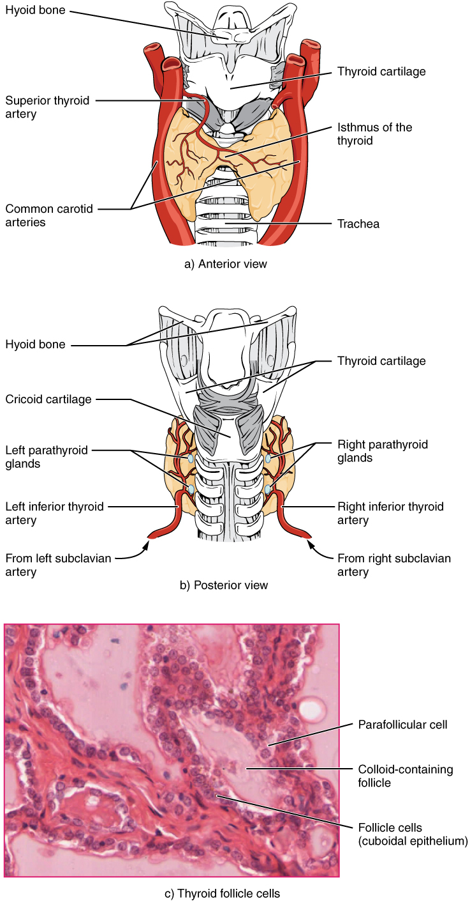
Visual location: x=7159155, y=229516, width=5032845, height=6398968 EMU.

## Slide 6

- Thyroid A&P

- The parathyroid glands sit on the posterior surface of the thyroid; they are distinct entities with their own regulation system and hormone production
- They have their own lecture and are not part of the thyroid lecture

Visual location: x=6830911, y=229516, width=5270948, height=6398968 EMU.

## Slide 7

- Thyroid A&P

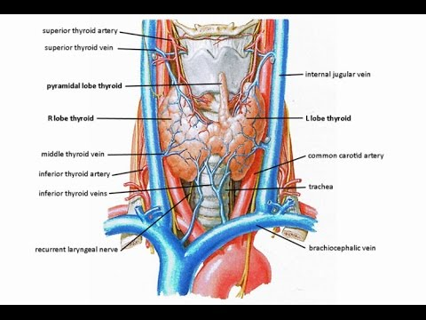
Visual location: x=6477000, y=1883569, width=5181600, height=3886200 EMU.

Diagram/resource text:
- The thyroid sits between the internal jugular veins and the common carotid arteries
- The 
- recurrent laryngeal nerve
-  branches off the vagus nerve and controls most muscles in the larynx

Diagram/resource text:
- The thyroid sits between the internal jugular veins and the common carotid arteries
- The 
- recurrent laryngeal nerve
-  branches off the vagus nerve and controls most muscles in the larynx

Additional slide resources:
- [Slide resource](../assets/thyroid-disease/resources/data2.xml)
- [Slide resource](../assets/thyroid-disease/resources/drawing2.xml)
- [Slide resource](../assets/thyroid-disease/resources/colors2.xml)
- [Slide resource](../assets/thyroid-disease/resources/quickStyle2.xml)
- [Slide resource](../assets/thyroid-disease/resources/layout2.xml)

## Slide 8

- Thyroid A&P

- The thyroid is composed of tiny sacs known as follicles – these are the functional units
- Each follicle is outlined by an epithelial lining and contains a substance known as colloid in the lumen
- The colloid holds both THYROGLOBULIN (which is a glycoprotein complex containing significant amounts of tyrosine) and IODINE

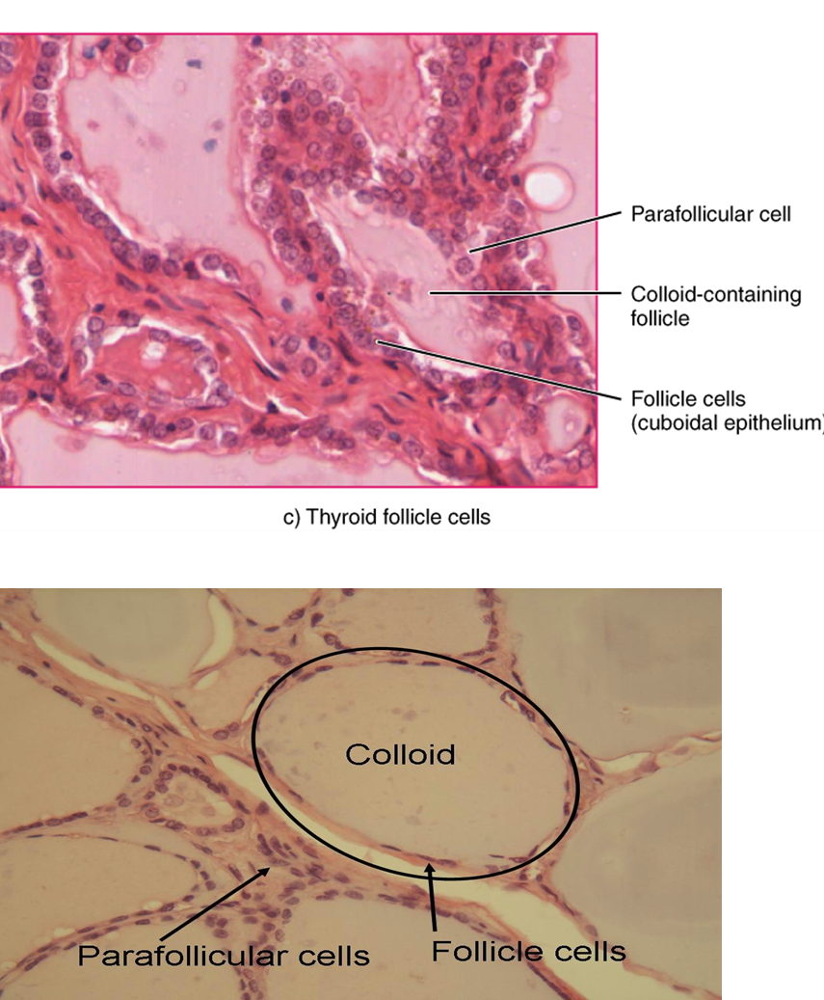
Visual location: x=0, y=621385, width=4625369, height=5615231 EMU.

## Slide 9

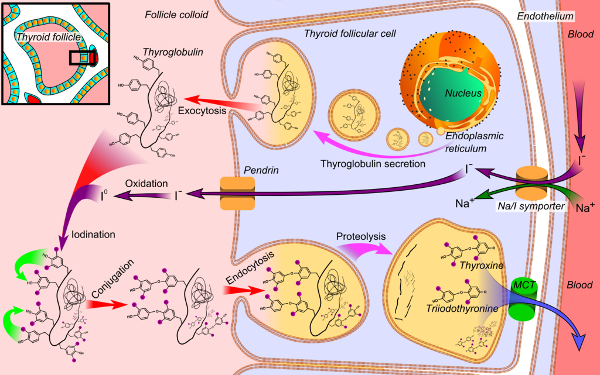
Visual location: x=607847, y=-12912, width=10976306, height=6870911 EMU.

- By Mikael Häggström, used with permission. - Mainly Own work Source image for nucleus derivative: (Public Domain license)

## Slide 10

- Thyroid A&P  

- Iodine is necessary in the production of the thyroid hormones
- It can be stored in the follicles for future use
  - The only source of iodine is dietary (in the form of iodide)
  - Daily consumption of 100-200 µg of dietary iodine is considered sufficient for normal processes
  - The thyroid cells contain 40x the amount of iodine than the bloodstream
- Peroxidase is an enzyme that oxidizes iodide into iodine inside the colloid

Visual location: x=8498131, y=0, width=3693869, height=2312275 EMU.

- By Mikael Häggström, used with permission. - Mainly Own work Source image for nucleus derivative: (Public Domain license)

## Slide 11

- Thyroid A&P  

- Iodine is very reactive and binds to tyrosine on the thyroglobulin molecules. This causes the thyroglobulin to form monoiodotyrosine and diiodotyrosine structures which will conjugate 
- When stimulated by TSH, the iodinated thyroglobulin enters the follicular epithelial cells. Through this process, proteases lyse the monoiodotyrosine and diiodotyrosine off

- By Mikael Häggström, used with permission. - Mainly Own work Source image for nucleus derivative: (Public Domain license)

Visual location: x=6952068, y=1807220, width=5181600, height=3243560 EMU.

## Slide 12

- Thyroid A&P

- When two diiodotyrosine residues couple together, they form Thyroxine (T4) --- the less active form
- When one monoiodotyrosine residue couples with a diiodotyrosine, it forms Triiodothyronine (T3) --- the more active form
  - Tissue receptors throughout the body have greater affinity for T3
- T4 and T3 (known as the thyroid hormones - TH) are released into the circulating blood

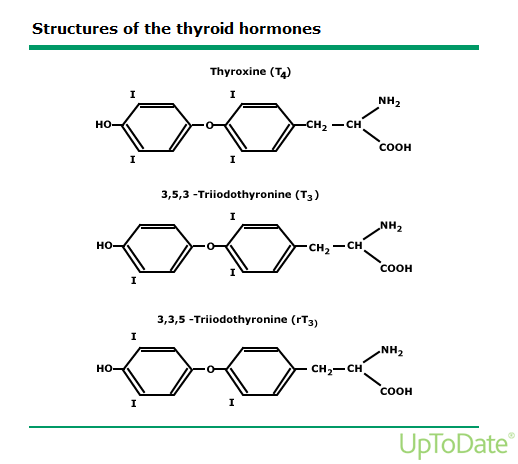
Visual location: x=7675658, y=2093976, width=3941064, height=4096512 EMU.

## Slide 13

- Thyroid A&P

- All of the circulating T4 is produced by the thyroid
- Only 20% of the circulating T3 is produced directly by the thyroid
- Since T3 is much more physiologic active than T4, it may be also be synthesized from T4 by a de-iodination process performed in peripheral tissues
  - Most predominately in the liver and kidney but almost any tissue type can convert it
  - 80% of the serum T3 is formed this way

Visual location: x=7675658, y=2093976, width=3941064, height=4096512 EMU.

## Slide 14

- Thyroid A&P 

- 99.5% of the thyroid hormones will bind to circulating plasma proteins to be transported through the blood
- The three major thyroid binding proteins are:
  - Thyroid hormone-binding globulin (TBG): carries most of T4 and T3
  - Albumin: carries some of T4 and T3
  - Transthyretin (TTR): carries a small amount of T4, negligible T3

## Slide 15

- Thyroid A&P 

- However, only FREE (unbound) hormones will be able to enter the target cells and regulate the feedback loop
  - 0.5% of the total thyroid hormones will circulate as free T4 and free T3
- The bound hormones must be cleaved from their proteins in order to be physiologically active, but this unbinding can happen promptly if needed
- The protein-bound thyroid hormones serve as a reservoir when free thyroid hormone is needed

## Slide 16

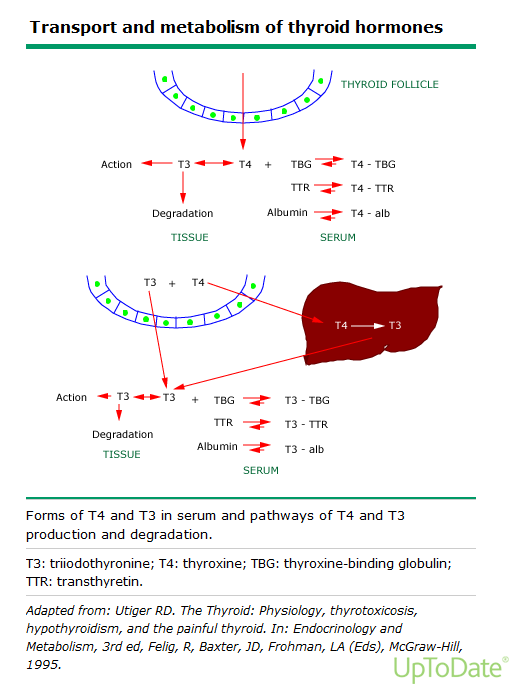
Visual location: x=3683000, y=0, width=4813300, height=6477000 EMU.

## Slide 17

- Neuroendocrine relationship

- For most endocrine glands to carry out their essential functions, they rely on a finely tuned neuroendocrine relationship
- https://medlineplus.gov/ency/anatomyvideos/000048.htm
  Link: https://medlineplus.gov/ency/anatomyvideos/000048.htm
- Hypothalamus: “master switchboard” – controls the endocrine system
- Pituitary: “master gland” – regulates activity of endocrine glands
- Hormones: chemical messengers
- Homeostasis: the optimal balance; able to steadily stay within preset limits

Additional slide resources:
- https://medlineplus.gov/ency/anatomyvideos/000048.htm

## Slide 18

- H-P-T axis

- The H-P-T axis is an example of a negative feedback loop
- The hypothalamus monitors the level of thyroid hormones (TH) in the circulating blood
  - The physiologic rise and subsequent fall of circulating TH continually happens but must be kept within a very narrow range

## Slide 19

- H-P-T axis

- When the level of thyroid hormone dips, the hypothalamus will increase secretion of Thyrotropin-Releasing Hormone (TRH)
  - TRH directly affects the anterior pituitary gland (hanging right below the hypothalamus) which will respond by increasing secretion of thyrotropin, more commonly known as Thyroid Stimulating Hormone (TSH)
  - TSH directly affects the thyroid gland which will stimulate production of the thyroid hormones (T4 and T3), thus increasing the level of TH in the circulating blood

## Slide 20

- H-P-T axis

- When the level of thyroid hormone RISES, both the hypothalamus and pituitary will be inhibited 
  - The hypothalamus will decrease TRH secretion
  - The anterior pituitary gland will decrease TSH secretion (directly and indirectly)
  - The thyroid gland will stop receiving stimuli to produce thyroid hormones (T4 and T3), thus the level in the circulating blood will fall
  - … And so the cycle continues normally

## Slide 21

Visual location: x=3507441, y=0, width=5177118, height=6858000 EMU.

## Slide 22

- H-P-T axis

- The constant monitoring and adjusting is a normal process which happens within a specified narrow range to maintain equilibrium
- We can measure these hormones through a serum blood draw to evaluate the functioning of this neuroendocrine relationship

## Slide 23

- The PA dept Analogy

- The Program Director (hypothalamus) tells the Academic Coordinator (pituitary) to let the faculty (thyroid) know they need to provide information to the students (thyroid hormone receptors on target tissues throughout the body). The program director and academic coordinator monitor the information given by the faculty. If the information is inadequate, they tell the faculty to do more. If the information is excessive, they tell the faculty to lighten up. With constant monitoring, the faculty can consistently adjust to meet the needs of the students.  

Visual location: x=268697, y=603073, width=2341302, height=3508139 EMU.

Visual location: x=2936924, y=1107537, width=2341302, height=2399967 EMU.

Visual location: x=5546326, y=579453, width=3212664, height=2409498 EMU.

Visual descr: A group of people in a room

Description automatically generated

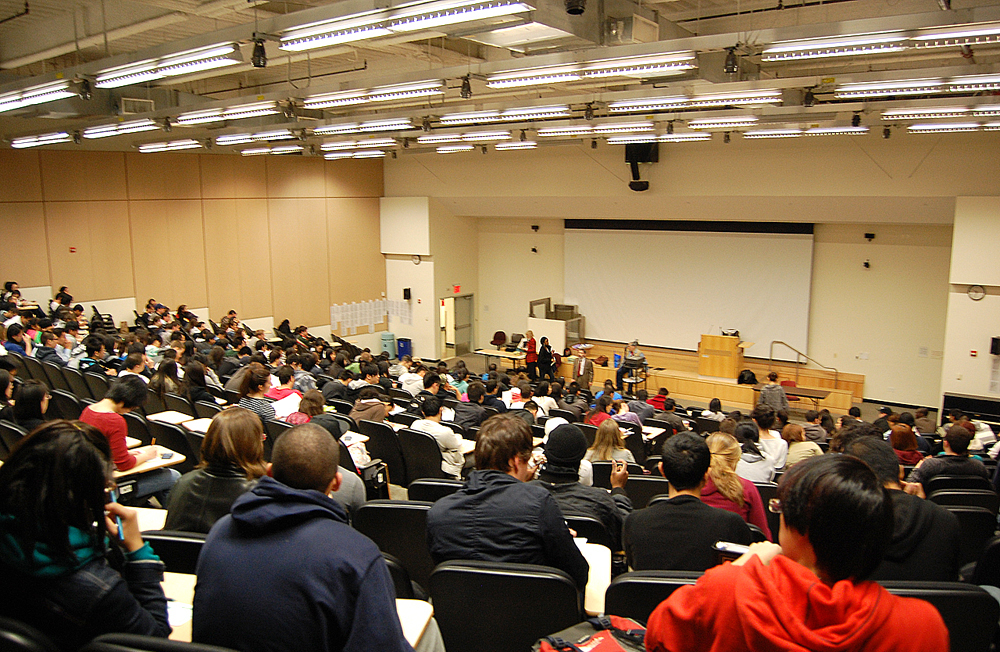
Visual location: x=8859591, y=1194352, width=3164769, height=2065012 EMU.

- This Photo by Unknown Author is licensed under CC BY-SA
  Link: https://en.wikipedia.org/wiki/Lecture_hall
  Link: https://creativecommons.org/licenses/by-sa/3.0/

- Hypothalamus

- Pituitary

- Thyroid

- Thyroid hormone receptors

Additional slide resources:
- https://creativecommons.org/licenses/by-sa/3.0/
- https://en.wikipedia.org/wiki/Lecture_hall

## Slide 24

- Let’s review!

## Slide 25

- H-P-T axis

- What do you remember about these hormones?
  - TRH = 
  - TSH = 
  - T3 & T4 = 

## Slide 26

- H-P-T axis

- Summarize the neuroendocrine organs:
  - Hypothalamus =
  - Pituitary (anterior) =
  - Thyroid =

## Slide 27

Visual location: x=20, y=10, width=12188930, height=6857990 EMU.

- Grab a sheet of paper and draw the H-P-T axis

## Slide 28

- Thyroid hormones (T4 and T3)

- Why do we care about T4 and T3?
  - ALL major organs in the body are affected by altered levels of thyroid hormones
- Two major functions: 
  - Regulates the metabolic rate in cells
  - Necessary for growth and development of children (considerably important for mental development) 

## Slide 29

- Thyroid hormones (T4 and T3)

- Metabolism
  - TH directly regulates the metabolism of all body tissues except retina, spleen, testes, and lungs (though these are indirectly affected)
  - Increases the usage rate of macronutrients (carbohydrates, lipids, and protein) and micronutrients (vitamins)
    - Lipids are mobilized from adipose tissue and catabolism of lipids in the liver is increased
    - Proteins are metabolized and used as energy
    - Glucose absorption from the GI tract increases, as well as gastric motility
    - Vitamins are essential components to metabolic processes in cells; thus increasing the cell metabolism will consume vitamin stores; in addition, increased gastric motility may decrease vitamin absorption

## Slide 30

- Thyroid hormones (T4 and T3)

- Metabolism --- affects on specific organ systems:  
  - Cardiovascular system – in the presence of thyroid hormone:
    - Increase in metabolism = rise in oxygen consumption and production of metabolic end products with an accompanying vasodilation
    - Blood volume, cardiac output and ventilation are increased to maintain blood flow and oxygen delivery to body tissues
    - Heart rate and cardiac contractility are enhanced to maintain necessary cardiac output
    - In abnormally high levels of TH, these effects will be pronounced (i.e. tachycardia, sweating, decreased cholesterol)
    - In abnormally low levels of TH, these effects will be diminished (i.e. bradycardia, cold extremities, increased cholesterol)

## Slide 31

- Thyroid hormones (T4 and T3)

- Metabolism --- affects on specific organ systems:  
  - Gastrointestinal - in the presence of thyroid hormone:
    - GI absorption of glucose increases
    - Gastric motility and secretions are increased
    - Appetite increases to accompany higher metabolic demands
    - In abnormally high levels of thyroid hormone, these effects will be pronounced (i.e. frequent bowel movements, weight loss, increased appetite)
    - In abnormally low levels of thyroid hormone, these effects will be diminished (i.e. constipation, weight gain, decreased appetite)

## Slide 32

- Thyroid hormones (T4 and T3)

- Metabolism --- affects on specific organ systems:  
  - Neuromuscular – in the presence of thyroid hormone:
    - Affects neural control of muscle function and tone: skeletal muscles react more vigorously
    - In abnormally high levels of thyroid hormone, these effects will be pronounced (i.e. tremor, muscle aches, fatigue)
    - In abnormally low levels of thyroid hormone, these effects will be diminished (i.e. sluggish response, muscle aches, fatigue)

## Slide 33

- Thyroid hormones (T4 and T3)

- Metabolism --- affects on specific organ systems:  
  - Neurologic – in the presence of thyroid hormone:
    - Mentation is enhanced:
      - Infants: necessary for normal brain development
      - Adults: psychomotor effects
    - In abnormally high levels of thyroid hormone, these effects will be pronounced (i.e. infants – brain damage; adults – nervousness, anxiety, poor sleep)
    - In abnormally low levels of thyroid hormone, these effects will be diminished (i.e. infants – poor brain development; adults – lethargy, “brain fog”, fatigue, hypersomnia)

## Slide 34

- Evaluation modalities

## Slide 35

- Labs

- We can assess the function of the H-P-T axis (through a serum blood draw) with thyroid function tests (TFTs)
  - TSH – this is the single best screening or initial test for thyroid dysfunction
    - Normal range: 0.4 - 4.0 milli-units/L
    - This can be variable for age (being more generous for the elderly)
    - 95% of “normal” adults will have a serum value: 3.0 milli-units/L or less
  - Serum total T4 or T3
    - Measures the total amount of thyroid hormone (bound + unbound)
  - Serum free T4 or T3
    - Measures only the unbound hormone (the amt of physiologically active hormone)

## Slide 36

- Labs

- Thyroid function tests (continued)
  - At most laboratories:
    - when TSH is low (<0.4), the lab will reflexively obtain a free T4 and T3 level on the same sample
    - When TSH is high (>4.0), the lab will reflexively obtain a free T4 level on the same sample
    - *if you’re lab doesn’t do this or you have suspicion despite a normal TSH level, you can always order these tests individually

## Slide 37

- Labs

- Clinical caveats to thyroid function tests
  - High doses of biotin (5 mg or more) can interfere with the assays used to measure TSH, T4, T3
    - Results falsely mimic hyperthyroidism (low TSH, high T3 / T4)
    - Patients need to stop any biotin supplements at least two days before obtaining thyroid function tests

## Slide 38

- Labs

- Clinical caveats to thyroid function tests
  - Pregnancy:
    - Increases demand for TH 
    - HCG also stimulates the thyroid
    - Estrogen increases the amount of binding proteins
    - *Normal TSH range is adjusted and narrowed to reflect these changes: 
    - 	0.1 to 2.5 mU/L

## Slide 39

- Labs

- Serum thyroglobulin measurements
  - Primarily used to follow-up patients with thyroid cancer
    - After treatment, this measurement should fall below <0.5mcg/L (anything greater indicates recurrent malignancy or metastatic disease)

## Slide 40

- Labs

- Thyroid autoantibodies, aka “antithyroid antibodies”
  - These develop in autoimmune conditions in which the pt's own immune system mistakenly targets the thyroid gland or thyroid proteins
    - Negative results = etiology is not auto-immune related
    - Positive results = etiology is likely auto-immune (higher levels = more correlation)
    - Thyroid peroxidase antibody (TPO Ab): MC antibody test
    - Thyroglobulin antibody (TGAb): antibody targets thyroglobulin, the storage form of thyroid hormone
    - TSH receptor antibodies (TRAb) – also known as thyrotropin receptor antibodies: attach to proteins in the thyroid to which TSH normally binds
      - Thyroid stimulating immunoglobulin (TSI) – promotes production of thyroid hormones
      - Thyroid binding inhibitory immunoglobulin (TBII) – inhibits production of thyroid hormones

- Hashimoto’s

- Grave’s

## Slide 41

- Screening for thyroid disease

- In the asymptomatic non-pregnant adult patient, “the current evidence is insufficient to assess the balance of benefits and harms of screening for thyroid dysfunction”
  - However, clinically it is common practice to screen for thyroid disease annually
  - TSH is usually the initial lab ordered
    - If TSH is normal, no further testing is needed
    - If TSH increased, assess free T4 to determine the degree of hypothyroidism
    - If TSH decreased, assess free T4 and T3 to determine the degree of hyperthyroidism

## Slide 42

- Screening for thyroid disease

- Screening in pregnancy is controversial but often performed
  - Again, initial test is TSH
- We don’t routinely order antibody testing for screening purposes (only order if there is a clinical reason)

## Slide 43

- Imaging modalities

- Ultrasonography – best initial imaging test for structural concerns (nodules, goiter). Low cost, non-invasive, no radiation
  - Readily differentiates cystic vs. solid lesions in the thyroid
  - Evaluates the size of the gland
  - Doppler U/S – indication of blood flow 
- MRI - best if concern for compression of adjacent structures (such as trachea or blood vessels) or to plan for surgery
  - CT okay if unable to obtain MRI or contraindications to MRI
- Non-contrast CT –best for orbitopathy (Grave’s disease)

## Slide 44

Visual location: x=7147033, y=0, width=4921469, height=3067498 EMU.

- Imaging modalities

- Radioactive Iodine Uptake Scan (RAIU scan)
  - Assesses the uptake of iodine by the thyroid
    - Can indicate “hot spots” or “cold spots”
  - Patients are given a pill of radioactive iodine (I-123 or I-131) to swallow
  - Usually at the 6- and 24-hour mark, the thyroid is assessed with a gamma probe
  - The radioactive iodine is filtered into the urine by the kidney over 24-48 hours
  - Contraindicated in pregnancy or breastfeeding

## Slide 45

- Imaging modalities

- Radioactive Iodine Uptake Scan (RAIU scan) - continued
  - Normal values: 
    - 6 hours: 3 to 16%
    - 24 hours: 8 to 25%
    - Uniform appearance
  - Values lower than expected: abnormally low functioning thyroid
  - Results higher than expected: abnormally high functioning thyroid
  - Cold spots: areas of low function
  - Hot spots: areas of high function

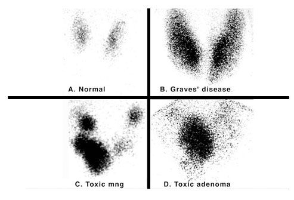
Visual location: x=7987859, y=1929384, width=4193627, height=4179499 EMU.

## Slide 46

- RAIU scan

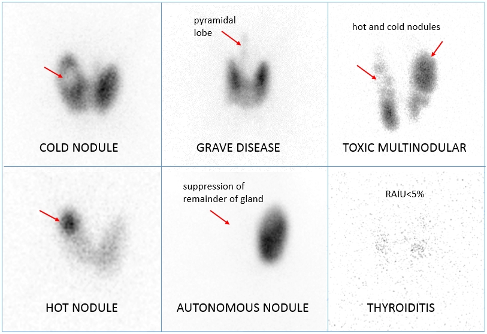
Visual location: x=320040, y=944278, width=7214616, height=4942011 EMU.

## Slide 47

- Histology

- Fine needle aspiration (FNA) biopsy
  - Usually under ultrasound guidance; differentiates benign and malignant nodules
  - Cytopathology is the definitive diagnosis for thyroid malignancy
    - Previous workup indicates the likelihood of malignancy, but it’s not confirmed until pathology results are known

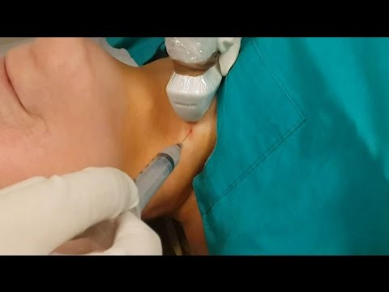
Visual location: x=1, y=10, width=4657344, height=6857990 EMU.

## Slide 48

- Let’s jog that short-term memory recall

- Lab tests:
- Imaging tests:
- Histology:

## Slide 49

- Hypothyroidism

Additional slide resources:
- [Embedded media](../assets/thyroid-disease/model3d1.glb)

## Slide 50

- Outline

Diagram/resource text:
- Overview of hypothyroidism
- Primary hypothyroidism
- Central Hypothyroidism
- Myxedema coma
- Hashimoto’s
- Iodine
- Iatrogenic
- Drugs
- Secondary
- Tertiary
- Congenital hypothyroidism

Diagram/resource text:
- Overview of hypothyroidism
- Primary hypothyroidism
- Hashimoto’s
- Iatrogenic
- Iodine
- Drugs
- Central Hypothyroidism
- Secondary
- Tertiary
- Myxedema coma
- Congenital hypothyroidism

Additional slide resources:
- [Slide resource](../assets/thyroid-disease/resources/data3.xml)
- [Slide resource](../assets/thyroid-disease/resources/drawing3.xml)
- [Slide resource](../assets/thyroid-disease/resources/colors3.xml)
- [Slide resource](../assets/thyroid-disease/resources/quickStyle3.xml)
- [Slide resource](../assets/thyroid-disease/resources/layout3.xml)

## Slide 51

- Hypothyroidism

- A defect anywhere in the H-P-T axis can cause reduced thyroid hormones
- Clinical spectrum can range from subclinical to emergent complication 
  - Myxedema coma is a serious, life-threatening complication of hypothyroidism 
- Multiple etiologies
  - Primary - Most Common  
    - Involve disorders that directly reduce thyroid hormones 
  - Central – less than 1% of cases
    - Involve disorders of the pituitary (secondary hypothyroidism) or hypothalamus (tertiary hypothyroidism), which under stimulates the thyroid gland

Additional slide resources:
- [Embedded media](../assets/thyroid-disease/model3d1.glb)

## Slide 52

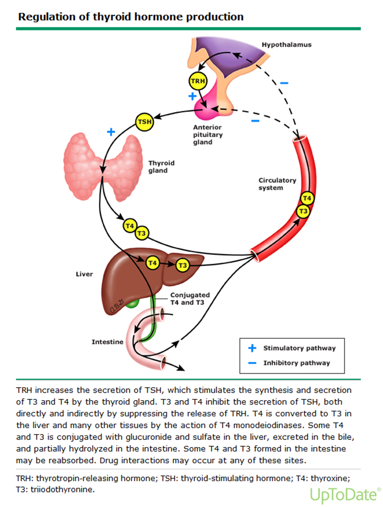
Visual location: x=2480288, y=145018, width=7301023, height=6567959 EMU.

- Normal H-P-T

- Primary hypothyroidism

Visual descr: No sign

Visual descr: Thumbs Down

Visual descr: Arrow Down

Visual descr: Arrow Up

Visual descr: Arrow Up

## Slide 53

Visual location: x=2480288, y=145018, width=7301023, height=6567959 EMU.

- Normal H-P-T

- Central hypothyroidism:
- Secondary

Visual descr: No sign

Visual descr: Thumbs Down

Visual descr: Arrow Down

Visual descr: Arrow Up

Visual descr: Arrow Up

Visual descr: Arrow Up

Additional slide resources:
- [Embedded media](../assets/thyroid-disease/model3d1.glb)

## Slide 54

Visual location: x=2480288, y=145018, width=7301023, height=6567959 EMU.

- Normal H-P-T

- Central hypothyroidism:
- Tertiary

Visual descr: No sign

Visual descr: Thumbs Down

Visual descr: Arrow Down

Visual descr: Arrow Up

Visual descr: Arrow Up

Visual descr: Arrow Up

Visual descr: Arrow Up

Additional slide resources:
- [Embedded media](../assets/thyroid-disease/model3d1.glb)

## Slide 55

- Hypothyroidism

- CAUSES:
  - Primary
    - MOST COMMON: Chronic autoimmune thyroiditis – “Hashimoto’s thyroiditis”
    - Iatrogenic
    - Iodine deficiency or excess
    - Drugs
    - Infiltrative diseases
    - Transient conditions
    - Congenital disease
  - Central 
    - Secondary: Pituitary disorders causing TSH deficiency
    - Tertiary: Hypothalamic disorders causing TRH deficiency

Additional slide resources:
- [Embedded media](../assets/thyroid-disease/model3d1.glb)

## Slide 56

- Hypothyroidism

- Clinical manifestations are more prominent when there is acute decline in thyroid hormones; patients generally tolerate symptoms better when there is gradual decline of functioning
- Wide variability but general may signs and symptoms include:

- Fatigue
- Depression
- Weight gain
- Cold intolerance
- Decreased sweating
- Coarse dry hair/skin
- Puffiness of face
- Decreased exercise capacity
- Sluggish movement 
- Myalgias
- Slower speech
- Constipation
- Bradycardia
- Hoarseness
- Menorrhagia/amenorrhea
- Fertility issues
- Delayed puberty
- “Brain fog”
- Mental retardation (infants)
- Goiter ?

Additional slide resources:
- [Embedded media](../assets/thyroid-disease/model3d1.glb)

## Slide 57

- Hypothyroidism

- Evaluation:
  - Patients with suggestive clinical s/s should initially have a TSH and reflex free T4
    - The combination of these two will help differentiate primary vs central hypothyroidism
  - In patients with primary hypothyroidism, TSH is high and free T4 is low 
    - Free T4 is normal in subclinical hypothyroidism
  - In patients with central hypothyroidism, TSH is not elevated (may be low or normal) and free T4 is low
    - These patients should undergo further evaluation with MRI and other hormonal assays

Additional slide resources:
- [Embedded media](../assets/thyroid-disease/model3d1.glb)

## Slide 58

- Hypothyroidism

- Other abnormal lab findings may result from hypothyroidism:
  - Hyperlipidemia
  - Normochromic, normocytic anemia
  - Hyponatremia
- Hypothyroidism may decrease the clearance of drugs (resulting in drug toxicity if not adjusted):
  - Anti-epileptic drugs
  - Anticoagulants
  - Opioids
  - Hypnotics

Additional slide resources:
- [Embedded media](../assets/thyroid-disease/model3d1.glb)

## Slide 59

- Hypothyroidism

- Generally, treatment of hypothyroidism is going to involve thyroid replacement therapy (i.e. levothyroxine)
  - Goals:
    - Restore normal thyroid hormone concentrations
    - Provide symptomatic relief
    - Prevent neurological deficits in newborns and children
    - Reverse biochemical abnormalities of hypothyroidism

Additional slide resources:
- [Embedded media](../assets/thyroid-disease/model3d1.glb)

## Slide 60

- Primary hypothyroidism

Additional slide resources:
- [Embedded media](../assets/thyroid-disease/model3d1.glb)

## Slide 61

- Primary Hypothyroidism

- Low T4 and T3 
  - Because the hypothalamus and pituitary are functioning normally, TSH will be increased in order to stimulate the thyroid to make more hormones
- 2 clinical categories:
  - Overt hypothyroidism: High TSH with low free T4
    - Typically patients have S/S consistent with hypothyroidism
  - Subclinical hypothyroidism: High TSH with normal T4 or T3
    - Typically patients have no symptoms or subtle symptoms 

Additional slide resources:
- [Embedded media](../assets/thyroid-disease/model3d1.glb)

## Slide 62

- Primary Hypothyroidism

- Major causes of Primary Hypothyroidism
  - MC: Chronic autoimmune thyroiditis
  - Iatrogenic – s/p thyroidectomy or radioiodine therapy/external irradiation
  - Iodine deficiency or excess
  - Congenital disease
  - Drugs
  - Transient hypothyroidism (discussed in thyroiditis section)

Additional slide resources:
- [Embedded media](../assets/thyroid-disease/model3d1.glb)

## Slide 63

- Primary Hypothyroidism

- Remember primary hypothyroidism is under functioning of the thyroid gland, so less T4 and T3 are produced. Because these serum levels drop, the hypothalamus and pituitary respond appropriately by secreting more TRH and TSH respectively
- Diagnosis of primary hypothyroidism:
  - Overt: 
    - TSH: elevated
    - Free T4: low
  - Subclinical
    - TSH: elevated
    - Free T4: normal

Additional slide resources:
- [Embedded media](../assets/thyroid-disease/model3d1.glb)

## Slide 64

- Primary Hypothyroidism

- We always treat overt hypothyroidism with Thyroid hormone replacement therapy 
    - Levothyroxine – synthetic T4 
      - It is converted to T3 by the liver and cells throughout the body as needed
      - - OR -
    - Liothyronine – synthetic T3
      - More potent than levothyroxine but much less preferred due to its rapid absorption and potential for toxicity
    - Comment regarding desiccated thyroid extract– natural 
      - Dosage inconsistencies
      - Originally used but no longer recommended since the advent of levothyroxine

Additional slide resources:
- [Embedded media](../assets/thyroid-disease/model3d1.glb)

## Slide 65

- Primary Hypothyroidism

- Recheck TSH after 6 weeks (if using levothyroxine) to evaluate if return to normal
  - If not yet in range, consider dosage adjustments and recheck TSH in 6 weeks. Continue this pattern until TSH is WNL
    - Always ensure compliance with medication and malabsorption is not occurring before adjusting dose
  - Once TSH is WNL (euthyroid), the dosage is maintained; monitor TSH yearly or onset of new/worsening symptoms
- Symptoms caused by hypothyroidism should abate over the next few months after euthyroid is achieved
  - if not, those symptoms are likely due to another etiology

Additional slide resources:
- [Embedded media](../assets/thyroid-disease/model3d1.glb)

## Slide 66

- Primary Hypothyroidism

- Treating subclinical hypothyroidism is controversial
  - If TSH between 5 - 10 mU/L, may trial thyroid hormone replacement therapy (levothyroxine) if presence of goiter, positive antibodies, or symptomatic
  - If TSH > 10 mU/L, patients are typically treated with thyroid hormone replacement therapy (levothyroxine)

Additional slide resources:
- [Embedded media](../assets/thyroid-disease/model3d1.glb)

## Slide 67

- Primary Hypothyroidism

- Before thyroid hormone replacement

- After thyroid hormone replacement

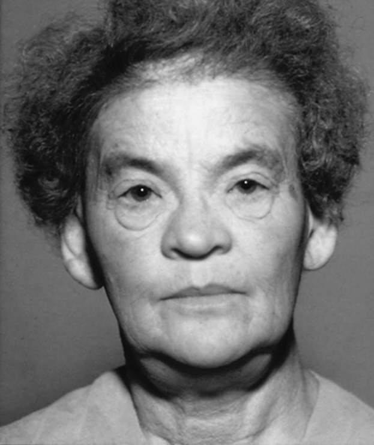
Visual location: x=2047793, y=2925763, width=2741776, height=3265487 EMU.

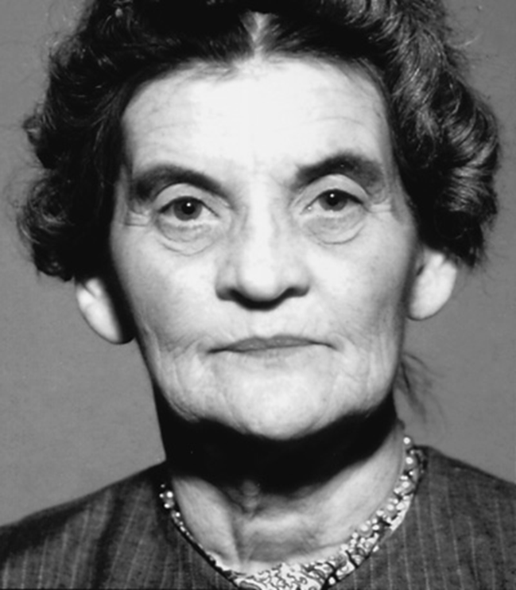
Visual location: x=7335694, y=2925763, width=2856200, height=3265487 EMU.

Additional slide resources:
- [Embedded media](../assets/thyroid-disease/model3d1.glb)

## Slide 68

- Primary Hypothyroidism

- Clinical caution:
  - Patients may desire increased dosing of thyroid hormone replacement for perceived weight loss benefits
    - However, the risk of over-dosing thyroid hormone replacement may produce serious, possibly life-threatening effects
    - The goal is euthyroid (TSH WNL)

Additional slide resources:
- [Embedded media](../assets/thyroid-disease/model3d1.glb)

## Slide 69

- Primary Hypothyroidism

- Maternal hypothyroidism
  - Cellular demand for thyroid hormone is increased during pregnancy
  - Associated negative outcomes of maternal hypothyroidism: pregnancy loss, preeclampsia, preterm, low birth weight, cognitive impairment of child, placental abruption
  - Pregnant patients with pre-existing hypothyroidism: levothyroxine dosage will usually need to be increased

Additional slide resources:
- [Embedded media](../assets/thyroid-disease/model3d1.glb)

## Slide 70

- Primary Hypothyroidism

- Maternal hypothyroidism (continued)
  - Screening of pregnant women is controversial but often performed
    - Subclinical or overt hypothyroidism identified: treat with levothyroxine
    - Goal = TSH in the lower half of normal (<2.5mIU/L) during pregnancy
  - Postpartum T4 requirements ordinarily return to pre-pregnancy levels

Additional slide resources:
- [Embedded media](../assets/thyroid-disease/model3d1.glb)

## Slide 71

- Etiologies of primary hypothyroidism

## Slide 72

- Primary Hypothyroidism:Chronic Autoimmune Thyroiditis

- Commonly known as Hashimoto’s thyroiditis
- Most common cause of primary hypothyroidism in developed countries
- Women > Men
- Increased risk in patients with trisomy 21 or Turner syndrome (screen early)
- Characterized by gradual thyroid failure due to inappropriate destruction of thyroid epithelial cells

Additional slide resources:
- [Embedded media](../assets/thyroid-disease/model3d1.glb)

## Slide 73

- Primary Hypothyroidism:Chronic Autoimmune Thyroiditis

- Loss of function is permanent, requiring lifelong treatment (levothyroxine)
- May have goiter
- Additional labs: Positive serum thyroid autoantibodies (i.e. thyroid peroxidase [TPO] antibodies)
  - Many times these are not ordered since it is so common; but consider obtaining if etiology is equivocal or to predict that a subclinical hypothyroidism will ultimately become overt hypothyroidism

Additional slide resources:
- [Embedded media](../assets/thyroid-disease/model3d1.glb)

## Slide 74

Visual descr: See the source image

Visual location: x=1250732, y=2303502, width=9198672, height=4481926 EMU.

- Primary Hypothyroidism:Chronic Autoimmune Thyroiditis

- Why does the immune system target the thyroid?

Additional slide resources:
- [Embedded media](../assets/thyroid-disease/model3d1.glb)

## Slide 75

- Primary Hypothyroidism:Iatrogenic

- Iatrogenic: “We” caused it
  - Total thyroidectomy: occurs within 2-4 weeks
  - Sub-total thyroidectomy: usually occurs within a year 
  - Radioiodine therapy (Tx for Graves’ disease): Usually occurs within 6 months 
  - External radiation of the neck area (i.e. head and neck cancer, Hodgkin’s lymphoma): gradual onset - usually takes years for overt hypothyroidism to develop

Additional slide resources:
- [Embedded media](../assets/thyroid-disease/model3d1.glb)

## Slide 76

- Primary Hypothyroidism:Disorders of Iodine

- Iodine deficiency = Intake less than 100mcg/day
  - Iodine is essential to the production of thyroid hormones
  - Most common cause of primary hypothyroidism and goiter world-wide
  -  Good history-taking should be able to identify if this is a likely cause
    - In areas of low-iodine intake, this is the assumed cause
  - Treatment is restoration of normal dietary iodide (either through supplementation or food intake) 

Additional slide resources:
- [Embedded media](../assets/thyroid-disease/model3d1.glb)

## Slide 77

- Primary Hypothyroidism:Disorders of Iodine

- Iodine excess (rare)
  - The body can normally handle excess iodine intake by inhibiting peroxidase for a few days and then resuming normal production of thyroid hormones, BUT in a few patients - particularly those who have underlying thyroid disease - this process malfunctions and the inhibition of peroxidase is maintained 
    - This doesn’t allow enough conversion of iodide to iodine, thus thyroid hormones can not be made in sufficient quantities
  - Typically transient and will resolve with cessation of excess iodine, though temporary thyroid hormone replacement may be needed
  - Sources: diet supplements, health tonics, over-iodized salt, excessive kelp, excessive betadine, amiodarone, iodinated contrast

Additional slide resources:
- [Embedded media](../assets/thyroid-disease/model3d1.glb)

## Slide 78

- Primary Hypothyroidism:Drug-Induced

- Drugs:
  - Methimazole, propylthiouracil (hyperthyroidism treatment)
  - Ethionamide (MDR tuberculosis treatment)
  - Lithium (treatment of mania)
  - Contains iodine:
    - Amiodarone (anti-arrhythmic)
    - Iodinated radiographic contrast 
    - Betadine douches/topical betadine
  - …others

Additional slide resources:
- [Embedded media](../assets/thyroid-disease/model3d1.glb)

## Slide 79

- Central hypothyroidism

## Slide 80

- Central Hypothyroidism

- Of all hypothyroidism, only 1% are due to central pathology
- Disorders in which thyroid hormones are deficient due to a disorder of the pituitary or hypothalamus
- When hypothyroidism has a central cause, the secretion of TSH fails to appropriately increase when thyroid hormones are low
  - In a normal feedback loop, if T4/T3 are low, the hypothalamus and pituitary will increase TRH and TSH in order to stimulate the thyroid
  - In central hypothyroidism, the hypothalamus or pituitary can’t respond normally so the thyroid hormones stay low
- If initial workup with labs and clinical presentation suggest central pathology, MRI of the hypothalamus and pituitary should be performed

Additional slide resources:
- [Embedded media](../assets/thyroid-disease/model3d1.glb)

## Slide 81

- Central Hypothyroidism

- TSH deficiency due to pituitary disorder (also known as secondary hypothyroidism)
  - Causes:
    - Pituitary tumor which is often a pituitary macroadenoma – MOST COMMON
    - Postpartum pituitary necrosis – known as Sheehan syndrome
    - Trauma
    - Radiation of the head
    - Gene mutations
    - Infiltrative disease

## Slide 82

- Central Hypothyroidism

- TRH deficiency due to hypothalamic disorder (also known as tertiary hypothyroidism)
  - Causes:
    - Tumors
    - Trauma
    - Radiation
    - Infiltrative diseases

Additional slide resources:
- [Embedded media](../assets/thyroid-disease/model3d1.glb)

## Slide 83

- Central Hypothyroidism

- Clinical manifestations are similar to primary hypothyroidism, but usually milder in nature
  - However, goiter is not usually present in central hypothyroidism
  - Patients also tend to have deficiency in other hormones released by the pituitary as well (i.e. hypogonadism)

Additional slide resources:
- [Embedded media](../assets/thyroid-disease/model3d1.glb)

## Slide 84

- Central Hypothyroidism

- Suspect central hypothyroidism in patients with known hypothalamic or pituitary disease (i.e. mass lesion in the pituitary) or Clinical s/s of hypothyroidism despite a normal TSH Evaluation:
  - TSH may be low or “inappropriately” normal and free T4 will be low
  - Obtain MRI to assess hypothalamus and pituitary
  - Labs to assess other hormones produced by the pituitary: prolactin, gonadotropins (FH, LSH), testosterone, estradiol, insulin-like growth factor-1 (rare for pituitary disease to only affect TSH)

Additional slide resources:
- [Embedded media](../assets/thyroid-disease/model3d1.glb)

## Slide 85

- Central Hypothyroidism

- Anti-seizure drugs can artificially lower free T4 with a normal TSH – mimicking central hypothyroidism 
  - If clinical concern, evaluate further with MRI, as well as other hormone assessments of the pituitary, to r/o central causes

Additional slide resources:
- [Embedded media](../assets/thyroid-disease/model3d1.glb)

## Slide 86

- Central Hypothyroidism

- Treatment to address the hypothyroidism:
  - Thyroid hormone replacement therapy (levothyroxine)
    - Monitor and titrate dose; Goal is to achieve T4 in upper part of normal ranges
    - TSH should not be used for assessment as it will likely be suppressed regardless of thyroid hormone replacement

Additional slide resources:
- [Embedded media](../assets/thyroid-disease/model3d1.glb)

## Slide 87

- Central Hypothyroidism

- Treatment to address the hypothyroidism:
  - Because other disorders are commonly present with pituitary disorders, you MUST r/o secondary adrenal insufficiency prior to starting levothyroxine by performing ACTH stimulation test
    - Administration of levothyroxine in these patients induces an acute adrenal crisis
    - If adrenal insufficiency is identified on testing, glucocorticoids should be given with levothyroxine
  - For pituitary tumors, surgical resection can sometimes reverse the hypothyroidism

Additional slide resources:
- [Embedded media](../assets/thyroid-disease/model3d1.glb)

## Slide 88

- Myxedema coma

## Slide 89

- Myxedema Coma

- Medical emergency
- State of metabolic and multi-organ decompensation as a result of severe hypothyroidism, usually in the presence of a stressor (i.e. surgery, trauma, infection)
  - Much less common now due to earlier detection and treatment of hypothyroidism
- High mortality rate 30-60%

Additional slide resources:
- [Embedded media](../assets/thyroid-disease/model3d1.glb)

## Slide 90

- Myxedema Coma

- Clinical presentation:
  - HALLMARK: Mental status changes/coma and hypothermia (< 35.5°C / 95.9 ° F)
  - Other findings:
    - Hypotension
    - Bradycardia
    - Hyponatremia
    - Hypoglycemia
    - Hypoventilation

Additional slide resources:
- [Embedded media](../assets/thyroid-disease/model3d1.glb)

## Slide 91

- Myxedema Coma

- Clinical presentation (continued):
  - Infection may be present but common features indicating an infection (i.e. tachycardia, fever/sweating, leukocytosis) may be masked by bradycardia & hypothermia
    - Hypothermia is so common in myxedema that a normal temp suggests underlying infection
  - Absence of shivering, hypothyroid habitus, psuedomyotonic reflexes can distinguish from accidental hypothermal

Additional slide resources:
- [Embedded media](../assets/thyroid-disease/model3d1.glb)

## Slide 92

- Myxedema Coma

- Evaluation:
  - Diagnosis suspected based on clinical presentation and confirmed by thyroid function tests: T4 is usually very low; TSH usually high (primary) but can be normal/low (central)
  - Other workup based on comorbidities and DDx:
    - Cortisol level – need to r/o concomitant adrenal insufficiency
    - EKG – bradycardia
    - ABGs – hypoxemia
    - CMP – assess electrolytes, kidney function, glucose 
    - CBC – assess infectious etiology
    - Blood cultures - r/o infection
    - Cardiac enzymes  -r/o MI
    - Head CT and Lumbar Puncture - r/o hemorrhage, stroke, and neuro infection
    - CXR – may see pleural effusion or CHF

Additional slide resources:
- [Embedded media](../assets/thyroid-disease/model3d1.glb)

## Slide 93

- Myxedema Coma

- Do not delay treatment while waiting for lab results
- Treatment should be aggressive, and pts admitted to ICU until stable
  - IV levothyroxine with bolus of 200 - 400mcg, followed by 50-100mcg IV daily until patient can transition to oral replacement
  - IV liothyronine is given at the same time: bolus of 5-20mcg, followed by 2.5 – 10mcg every 8 hours. Once stable, liothyronine is discontinued

Additional slide resources:
- [Embedded media](../assets/thyroid-disease/model3d1.glb)

## Slide 94

- Myxedema Coma

- Until cortisol results are known, high-dose glucocorticoid (i.e. hydrocortisone 100mg IV q 8 hours) is given
  - If cortisol normal, rules out adrenal insufficiency and glucocorticoid can be discontinued
  - If cortisol low, glucocorticoid is continued (usually at lower doses)

Additional slide resources:
- [Embedded media](../assets/thyroid-disease/model3d1.glb)

## Slide 95

- Myxedema Coma

- Supportive therapy is necessary until stabilized:
  - Mechanical ventilation
  - Judicious IV fluids for hypotension and hyponatremia (avoid volume overload)
  - IV dextrose for hypoglycemia
  - IV vasopressors for severe hypotension (BP will self-correct after a few days of thyroid hormone replacement)
  - Passive re-warming (i.e. blanket) for hypothermia
  - Empiric IV antibiotics to treat for potential infection (d/c if blood culture results are negative)

Additional slide resources:
- [Embedded media](../assets/thyroid-disease/model3d1.glb)

## Slide 96

- Myxedema Coma

- Monitoring:
  - Assess T4 and T3 daily: confirm therapeutic range and detect if T3 dosage is too high
  - TSH typically falls at a rate of 50% per week
  - Cardiac monitoring for arrythmias is essential while receiving high dose thyroid replacement
- Follow-up
  - Once stabilized and discharged, pt must be followed by endocrinologist
    - Levothyroxine therapy will continue

Additional slide resources:
- [Embedded media](../assets/thyroid-disease/model3d1.glb)

## Slide 97

- Congenital hypothyroidism

## Slide 98

- Congenital Hypothyroidism

- Preventable cause of intellectual disability
- 1 in 2000 newborns worldwide
- The longer it remains undetected and untreated, the lower the IQ
- In US, screening of TSH or T4 is performed on the newborn heel stick

Additional slide resources:
- [Embedded media](../assets/thyroid-disease/model3d1.glb)

## Slide 99

- Congenital Hypothyroidism

- Hypothyroidism can result from primary (more common) or central disease
  - MC primary cause: 
    - in US: dysgenesis (defect in gland development) or dyshormonogenesis (defect in hormone synthesis) – needs thyroid replacement
    - World-wide: iodine deficiency – improving iodine intake will lead to normal function
  - MC central cause: pituitary gland developmental defect

Additional slide resources:
- [Embedded media](../assets/thyroid-disease/model3d1.glb)

## Slide 100

- Congenital Hypothyroidism

- In utero, the normal fetal thyroid begins synthesizing thyroid hormones around 11 weeks but relies on maternal TH through 20 weeks
  - Needs maternal intake of iodine for the entire pregnancy
- Maternal thyroid hormones (assuming mother has normal thyroid functioning) can cross the placenta and support the fetus throughout the pregnancy if needed
  - Thus infants are typically asymptomatic at birth

Additional slide resources:
- [Embedded media](../assets/thyroid-disease/model3d1.glb)

## Slide 101

- Congenital Hypothyroidism

- After birth, the maternal hormones are no longer present and a baby with an under-functioning thyroid will begin to have symptoms in a few weeks/months
  - Lethargy, hoarse cry, feeding issues, constipation, face puffiness, enlarged tongue, hypotonia, dry skin, hypothermia, prolonged jaundice
  - If hypothyroidism remains undetected, brain development will suffer and mental retardation ensues
  - Associations with other congenital malformations, mostly cardiac

Additional slide resources:
- [Embedded media](../assets/thyroid-disease/model3d1.glb)

## Slide 102

- Congenital Hypothyroidism

- Diagnosis and management of the infant:
  - High TSH, low free T4: primary hypothyroidism  start levothyroxine
  - High TSH, normal free T4: subclinical hypothyroidism  if TSH >20mIu/L, start levothyroxine; if less than 20, recheck thyroid function tests in one week
  - Low/normal TSH, low free T4: central hypothyroidism  more workup needed, but start levothyroxine
  - *Same concept as adult values but normal ranges are adjusted for infants

Additional slide resources:
- [Embedded media](../assets/thyroid-disease/model3d1.glb)

## Slide 103

- What do you recall about hypothyroidism?

- S/S
- Primary:
- Central:
- Myxedema coma:
- Congenital hypothyroidism:

## Slide 104

- Hyperthyroidism

Additional slide resources:
- [Embedded media](../assets/thyroid-disease/model3d2.glb)

## Slide 105

- Outline

Diagram/resource text:
- Overview of hyperthyroidism
- Graves’ Disease
- Toxic Multinodular Goiter
- Thyroid Storm

Diagram/resource text:
- Overview of hyperthyroidism
- Graves’ Disease
- Toxic Multinodular Goiter
- Thyroid Storm

Additional slide resources:
- [Embedded media](../assets/thyroid-disease/model3d2.glb)
- [Slide resource](../assets/thyroid-disease/resources/data4.xml)
- [Slide resource](../assets/thyroid-disease/resources/drawing4.xml)
- [Slide resource](../assets/thyroid-disease/resources/colors4.xml)
- [Slide resource](../assets/thyroid-disease/resources/quickStyle4.xml)
- [Slide resource](../assets/thyroid-disease/resources/layout4.xml)

## Slide 106

- Hyperthyroidism

- AKA thyrotoxicosis
- Clinical syndrome that results from elevated circulating thyroid hormones
  - “overactive thyroid” --- accelerates metabolism, increases cardiac activity
- Women > men
  - Toxic nodular goiter more common in older women
  - Graves’ disease more common in younger women
- More common in smokers
- May be primary or central (much less common)

Additional slide resources:
- [Embedded media](../assets/thyroid-disease/model3d2.glb)

## Slide 107

- Hyperthyroidism

- Common causes
  - MC: Graves’ Disease 
  - Toxic Adenoma (solitary)
  - Toxic Multinodular goiter
- Less common causes
  - Subacute thyroiditis (aka de Quervain or granulomatous thyroiditis)
  - Hashimoto’s thyroiditis with transient hyperthyroid phase
  - Thyrotoxicosis factitia (ingesting exogenous thyroid replacement)
  - Postpartum 
- Rare Causes
  - Struma Ovarii-ovarian tumor comprised of  >50% thyroid tissue
  - Metastatic thyroid carcinoma
  - Hydatidiform mole
  - Thyroid-stimulating hormone-secreting pituitary tumor

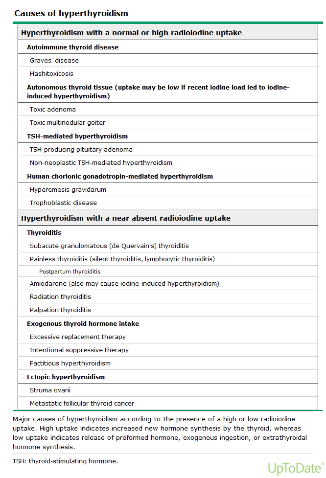
Visual location: x=7585842, y=99958, width=4406900, height=6477000 EMU.

Additional slide resources:
- [Embedded media](../assets/thyroid-disease/model3d2.glb)

## Slide 108

- Hyperthyroidism

- Primary hyperthyroidism: caused by excessive production of thyroid hormones from the thyroid gland
- Central hyperthyroidism: caused by excessive production of thyroid-releasing hormone (TRH) or thyroid-stimulating hormone (TSH) from the hypothalamus and the pituitary respectively 
  - Very rare

Additional slide resources:
- [Embedded media](../assets/thyroid-disease/model3d2.glb)

## Slide 109

Visual location: x=2480288, y=145018, width=7301023, height=6567959 EMU.

- Normal H-P-T

- Primary hyperthyroidism

Visual descr: Fast Forward

Visual descr: Upward trend

Visual descr: Arrow Down

Visual descr: Arrow Up

Visual descr: Arrow Up

## Slide 110

Visual location: x=2480288, y=145018, width=7301023, height=6567959 EMU.

- Normal H-P-T

- Central hyperthyroidism:
- Secondary

Visual descr: Fast Forward

Visual descr: Upward trend

Visual descr: Arrow Up

Visual descr: Arrow Up

Visual descr: Arrow Up

## Slide 111

Visual location: x=2480288, y=145018, width=7301023, height=6567959 EMU.

- Normal H-P-T

- Central hyperthyroidism:
- Tertiary

Visual descr: Fast Forward

Visual descr: Upward trend

Visual descr: Arrow Down

Visual descr: Arrow Up

Visual descr: Arrow Up

Visual descr: Arrow Up

Visual descr: Arrow Up

## Slide 112

- Hyperthyroidism

- General clinical signs and symptoms of hyperthyroidism:

  - Fatigue and weakness
  - Weight Loss
  - Anxiety/nervousness
  - Insomnia
  - Hyperreflexia
  - Fine tremor
  - Increased appetite
  - Frequent bowel movements
  - Palpitations/Tachycardia
  - Arrythmias (i.e. atrial tachycardias)
  - Heat Intolerance
  - Sweating
  - SOB
  - Lid lag
  - Fertility issues
    - Decreased libido, ED, decreased sperm count and gynecomastia
    - Oligomenorrhea
  - Goiter ?
  - Exophthalmos ?
  - Pre-tibial myxedema?

Additional slide resources:
- [Embedded media](../assets/thyroid-disease/model3d2.glb)

## Slide 113

- Hyperthyroidism

- Other abnormal lab findings may result from hyperthyroidism:
  - Low total and HDL cholesterol
  - Hypercalcemia
  - Elevated alkaline phosphatase
  - Normochromic, normocytic anemia (yes, again)
  - Decreased granulocytes

Additional slide resources:
- [Embedded media](../assets/thyroid-disease/model3d2.glb)

## Slide 114

- Hyperthyroidism

- Complications
  - Cardiac: refractory a-fib with RVR, thyrotoxic cardiomyopathy, CHF
    - Most often in elderly or those with existing CAD/ valvular disease
  - Hypokalemic periodic paralysis: extreme muscle weakness and low potassium levels, usually triggered by exercise, fasting or high carb meal
    - Most often in Asian or Native American men
  - Osteoporosis due to increased bone resorption
  - Hypercalcemia due to increased breakdown of bone 
  - Nephrolithiasis due to hypercalcemia

Additional slide resources:
- [Embedded media](../assets/thyroid-disease/model3d2.glb)

## Slide 115

- Hyperthyroidism

- Diagnosis:
  - Thyroid function tests:
    - Overt primary hyperthyroidism: low TSH and high free T4 and/or free T3
      - Graves disease or nodular goiter: T3 elevation is greater than T4 elevation
      - Some patients may have T3-toxicosis: High free T3 but normal T4, low TSH
      - Some patients may have T4-toxicosis: High T4 but normal T3, low TSH
    - Subclinical primary hyperthyroidism: low TSH and normal T4 and T3

Additional slide resources:
- [Embedded media](../assets/thyroid-disease/model3d2.glb)

## Slide 116

- Hyperthyroidism

- Diagnosis:
  - Thyroid function tests:
    - Central hyperthyroidism: high or inappropriately normal TSH despite high free T4 and T3 concentrations
      - Very rare but can occur
      - Perform MRI of pituitary and hypothalamus (TSH-secreting adenoma)

Additional slide resources:
- [Embedded media](../assets/thyroid-disease/model3d2.glb)

## Slide 117

- Hyperthyroidism

- Evaluation:
  - The etiology should be identified once hyperthyroidism is diagnosed
    - New-onset ophthalmopathy + large non-nodular thyroid = Grave’s disease
    - If not obvious etiology, further workup includes:
      - Radioactive iodine uptake scan
      - TSH receptor antibodies (TRAb): 
        - Positive = Grave’s disease
      - MRI if TFTs indicate central cause (TSH-secreting adenoma)

Additional slide resources:
- [Embedded media](../assets/thyroid-disease/model3d2.glb)

## Slide 118

- Hyperthyroidism

Visual location: x=8387256, y=114601, width=3804744, height=3290873 EMU.

- RAIU scan
  - High: the thyroid is the source of excessive T3 and T4 
    - Graves’ disease (MC), Toxic adenoma, Toxic multinodular goiter
  - Low/absent: extrathyroidal source or thyroid tissue destruction 
    - Thyroiditis, thyroid hormone replacement therapy, ectopic production of thyroid hormone

Additional slide resources:
- [Embedded media](../assets/thyroid-disease/model3d2.glb)

## Slide 119

- Hyperthyroidism

- Treatment goals

- Normalize thyroid levels 
- Reverse signs and symptoms
- Prevent thyroid storm
- Reduce Goiter size
- Improve cardiac function 
- Preserve bone density and prevent osteoporosis

- General treatment

- Symptomatic: beta blocker (atenolol or propranolol) 
- Medication to decrease thyroid hormone synthesis: Methimazole and Propylthiouracil (PTU) 
- Definitive treatment: radioiodine ablation or surgical removal of thyroid

Additional slide resources:
- [Embedded media](../assets/thyroid-disease/model3d2.glb)

## Slide 120

- Etiologies of primary hyperthyroidism

Additional slide resources:
- [Embedded media](../assets/thyroid-disease/model3d2.glb)

## Slide 121

- Graves’ disease

## Slide 122

- Primary Hyperthyroidism:Graves’ Disease

- Autoimmune disease in which thyrotropin-receptor antibodies (TRab) accentuate TSHR (Thyroid stimulating hormone receptors)
  - This stimulates hormone synthesis and secretion as well as promotes thyroid growth
- Most common cause of hyperthyroidism
- Hyperthyroidism + goiter + orbitopathy and usually dermopathy (myxedema)
- TSH: low
- Free T4 and T3: high

Additional slide resources:
- [Embedded media](../assets/thyroid-disease/model3d2.glb)

## Slide 123

- Primary Hyperthyroidism:Graves’ Disease

- Orbitopathy / ophthalmopathy
  - Occurs in ¼ of patients with Graves’ disease
  - Adipose cells and fibroblasts in the retro-orbital area are activated via the autoimmune activity in Graves’ disease. This causes accumulation of fluid and swelling in extra-ocular muscles, retro-orbital connective and adipose tissues. Subsequently, pressure increases within the orbits and the eyes displace forward with a bulging, staring appearance
    - This appearance is called exophthalmos or proptosis

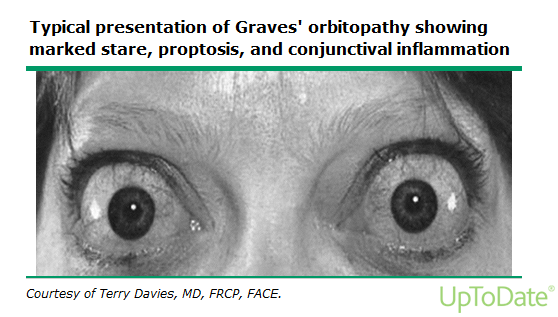
Visual location: x=9242854, y=4362, width=2949146, height=1675411 EMU.

Additional slide resources:
- [Embedded media](../assets/thyroid-disease/model3d2.glb)

## Slide 124

- Primary Hyperthyroidism:Graves’ Disease

- Orbitopathy / ophthalmopathy (continued)
  - Ocular symptoms: proptosis, lid lag with downward gaze, stare, periorbital edema, dry eyes, eye discomfort, vision changes (diplopia, blurry, occasionally loss of vision)
  - Clinical course is varied – most have mild disease with no progression, however others will have significant worsening
    - Increased risk for worsening disease: smokers, those with history of radioiodine, increased age, and poorly controlled thyroid function

Visual location: x=9242854, y=4362, width=2949146, height=1675411 EMU.

Additional slide resources:
- [Embedded media](../assets/thyroid-disease/model3d2.glb)

## Slide 125

- Primary Hyperthyroidism:Graves’ Disease

- Orbitopathy / ophthalmopathy (continued)
  - Evaluation tools:
    - Visual acuity
    - Clinical activity score (CAS) is used in-office to assess severity and changes over time
    - Exophthalmometer: measures amount of proptosis (normal ranges on next slide)
    - Non-contrast CT of the orbits is preferred imaging: measures amount of proptosis and fat accumulation, assesses presence of optic nerve compression, and can help rule out other causes
      - Better visualization of bone and intra-orbital volume than MRI
      - Do not use iodinated contrast (may worsen disease)

Visual descr: Differential Diagnosis of Proptosis

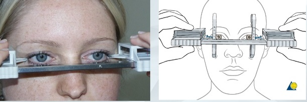
Visual location: x=7129980, y=0, width=5062020, height=1690688 EMU.

Additional slide resources:
- [Embedded media](../assets/thyroid-disease/model3d2.glb)

## Slide 126

- Primary Hyperthyroidism:Graves’ Disease

- Mild orbitopathy: <3mm ULN, no vision changes, mild affect on daily life
- Moderate: 3mm+ ULN, intermittent double vision, impacts daily life
- Severe: 3mm+ ULN, constant double vision, impacts daily life
- Sight-threatening: vision loss, corneal breakdown - urgent

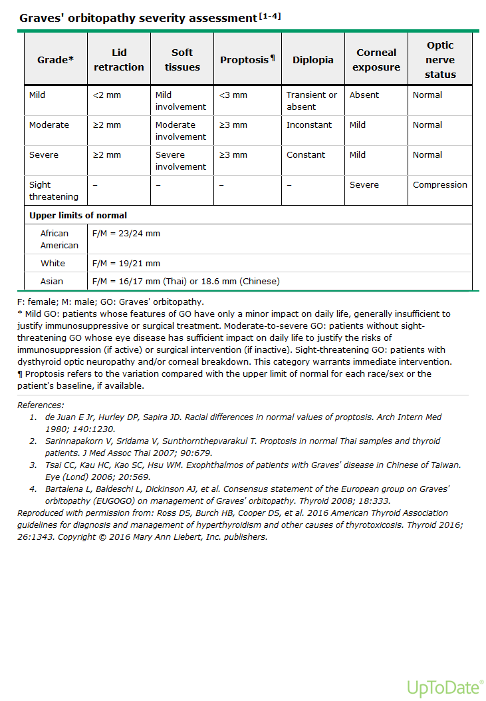
Visual location: x=8014827, y=1928432, width=3829642, height=4252912 EMU.

Additional slide resources:
- [Embedded media](../assets/thyroid-disease/model3d2.glb)

## Slide 127

- Primary Hyperthyroidism:Graves’ Disease

- Orbitopathy / ophthalmopathy (continued)
  - Treatment for all Graves’ orbitopathy:
    - Protect the eyes: artificial tears to prevent corneal drying (risk of abrasion), sleep with head elevated
    - Smoking cessation
    - Treat the underlying hyperthyroidism
      - Radioiodine ablation is contraindicated in moderate to severe orbitopathy
      - If mild, may perform radioiodine ablation but corticosteroids are given simultaneously

Additional slide resources:
- [Embedded media](../assets/thyroid-disease/model3d2.glb)

## Slide 128

- Primary Hyperthyroidism:Graves’ Disease

- Orbitopathy / ophthalmopathy (continued)
  - Treatment specific for Moderate to Severe orbitopathy: 
    - 1st line: glucocorticoids (i.e. oral prednisone or pule therapy with IV methylprednisolone)
    - Other options:
      - External orbital radiation, Orbital decompression surgery, and monoclonal antibodies
  - Treatment for sight-threatening orbitopathy: 
    - URGENT to prevent permanent vision loss: IV dexamethasone and orbital decompression surgery

Visual location: x=9242854, y=4362, width=2949146, height=1675411 EMU.

Additional slide resources:
- [Embedded media](../assets/thyroid-disease/model3d2.glb)

## Slide 129

- Primary Hyperthyroidism:Graves’ Disease

- Goiter
  - Not unique to Graves’ but a common feature of Graves’
  - TSH receptor antibodies (TRAb) stimulate the TSH receptor to increase thyroid growth

Additional slide resources:
- [Embedded media](../assets/thyroid-disease/model3d2.glb)

## Slide 130

- Primary Hyperthyroidism:Graves’ Disease

- Dermatopathy: known as pretibial myxedema
  - Unique to Graves’ disease
  - “Orange-peel”: Raised, nonpitting, scaly thickening with distinct borders
  - Most often on bilateral lower legs/feet
  - Topical glucocorticoids to minimize inflammation
    - Intra-lesional steroids can be used if no improvement

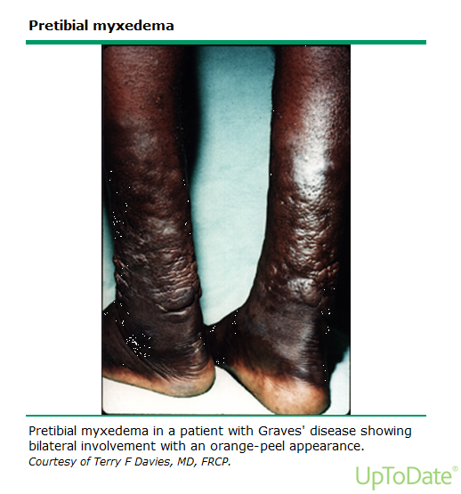
Visual location: x=8156454, y=-5, width=4035547, height=4178808 EMU.

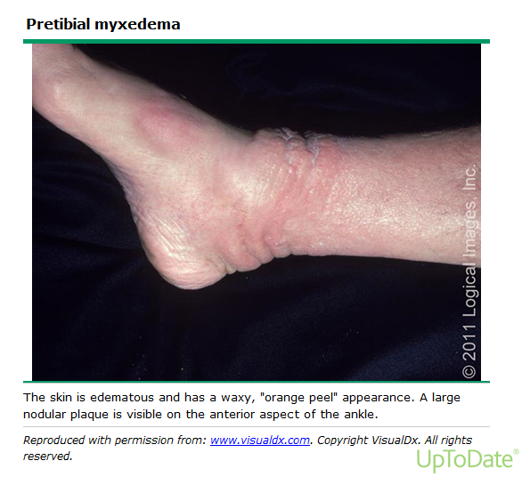
Visual location: x=8144356, y=4362195, width=4047645, height=2495811 EMU.

Additional slide resources:
- [Embedded media](../assets/thyroid-disease/model3d2.glb)

## Slide 131

- Primary Hyperthyroidism:Graves’ Disease

- Diagnosis:
  - Low TSH, high T4 / T3 + orbitopathy + goiter is enough to confirm the diagnosis
  - If uncertain etiology, may obtain thyroid antibody testing: positive (TRAb)
  - If nodules on physical exam or uncertain etiology, obtain RAIU scan = Uniform elevated uptake

Additional slide resources:
- [Embedded media](../assets/thyroid-disease/model3d2.glb)

## Slide 132

- Primary Hyperthyroidism:Graves’ Disease

- Treatment:
  - Most patients should receive a Beta blocker: improves palpitations, tachycardia, anxiety, tremors, heat intolerance, fatigue, dyspnea
    - Most commonly used: propranolol or atenolol
  - Targeted therapy can include one or multiple of the following:
    - Antithyroid medication (thionamides)
    - Radioiodine ablation
    - Surgery
  - Future: immunotherapy

Additional slide resources:
- [Embedded media](../assets/thyroid-disease/model3d2.glb)

## Slide 133

- Primary Hyperthyroidism:Graves’ Disease

- Thionamides
  - Methimazole: preferred
    - Longer duration/once daily dosing, rapid efficacy, less side effects
    - Do not use in 1st trimester pregnancy
  - Propylthiouracil (PTU): originally used but less favored now
    - Preferred drug in 1st trimester pregnancy
    - Higher risk of liver toxicity

Additional slide resources:
- [Embedded media](../assets/thyroid-disease/model3d2.glb)

## Slide 134

- Primary Hyperthyroidism:Graves’ Disease

- Thionamides
  - Attains euthyroid state within 3-8 weeks so can be very helpful (with beta blocker) to control symptoms as well as diminish small goiters
  - Some patients achieve euthyroid, but recurrence rates are high after discontinuing drug
    - Consider definitive therapy
  - Need to monitor CBC (risk of agranulocytosis) and LFTs (risk of hepatoxicity)
  - Assess thyroid function tests every 6 weeks until stable
    - Once stable, repeat every 6 months

Additional slide resources:
- [Embedded media](../assets/thyroid-disease/model3d2.glb)

## Slide 135

- Primary Hyperthyroidism:Graves’ Disease

- Radioiodine ablation
  - Definitive therapy; induces hypothyroidism
  - Less expensive and “safer” than surgery
  - Potential to worsen orbitopathy
  - Good choice for patients with mild, well-tolerated symptoms and those who are not surgical candidates
  - Patients are given oral I-131 which is absorbed by the thyroid. Permanent tissue destruction results in 6-18 weeks
    - Occasionally, patients will need a second treatment

Additional slide resources:
- [Embedded media](../assets/thyroid-disease/model3d2.glb)

## Slide 136

- Primary Hyperthyroidism:Graves’ Disease

- Radioiodine ablation (continued)
  - Need to follow radiation precautions following treatment
    - avoid contact with children, pregnant women for a period
  - Contraindicated in pregnancy and breastfeeding
  - S/p ablation, patients likely become hypothyroid and require life-long thyroid hormone replacement (levothyroxine)
    - Reassess thyroid function every 6 weeks until stable on levothyroxine

Additional slide resources:
- [Embedded media](../assets/thyroid-disease/model3d2.glb)

## Slide 137

- Primary Hyperthyroidism:Graves’ Disease

- Thyroidectomy (surgery)
  - Definitive therapy
  - Can be total or sub-total
  - Significant risks, not recommended for those with high-risk conditions
  - Biggest concerns: recurrent laryngeal nerve damage and removal of parathyroid glands
  - Good choice for severe hyperthyroidism + large goiter or suspicious nodules or those with mod-severe orbitopathy
  - Thyroid hormone replacement should be initiated when patient becomes hypothyroid; reassess every 6 weeks until stable on levothyroxine

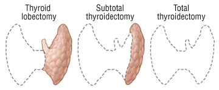
Visual location: x=8270328, y=1851792, width=3429000, height=1409700 EMU.

Additional slide resources:
- [Embedded media](../assets/thyroid-disease/model3d2.glb)

## Slide 138

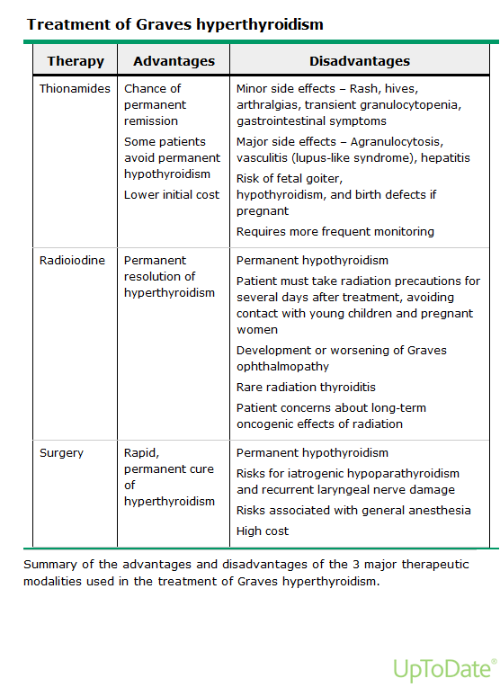
Visual location: x=7199588, y=0, width=4992412, height=6860076 EMU.

- Primary Hyperthyroidism:Graves’ Disease

- Individual patient factors
  - Mild hyperthyroidism: thionamides preferred
  - Severe hyperthyroidism: definitive treatment preferred
  - Pregnant: RAI contraindicated
  - High-risk surgical patients (elderly): thionamides or RAI preferred
  - Large goiter or suspicious nodules: surgery preferred
  - Hx agranulocytosis or hepatitis: thionamides contraindicated
  - Mod-severe orbitopathy: RAI not preferred

Additional slide resources:
- [Embedded media](../assets/thyroid-disease/model3d2.glb)

## Slide 139

- Toxic Multinodular Goiter

## Slide 140

- Primary Hyperthyroidism:Toxic Multinodular Goiter

- Also known as “Plummer’s disease”
- Common cause of hyperthyroidism but less common than Graves’
- More common in older (60+) women
- Excess thyroid hormones are produced from multiple nodules in the thyroid (toxic multinodular goiter) or a single nodule (toxic adenoma)
  - The development of these nodules is not entirely understood but appears to involve TSH-receptor gene mutations
    - Association with iodine deficiency
  - These nodules function regardless of stimulation by TSH
- S/S are that of hyperthyroidism + goiter

Additional slide resources:
- [Embedded media](../assets/thyroid-disease/model3d2.glb)

## Slide 141

- Primary Hyperthyroidism:Toxic Multinodular Goiter

- Suspect when nodular findings are present on physical exam with lab findings of hyperthyroidism (low TSH, high T4/T3)
  - Antibody testing is NEGATIVE
  - RAIU scan demonstrates high uptake with multiple “hot spots”
    - Toxic adenoma would show one focal hot spot

Visual location: x=9322676, y=4376209, width=2869324, height=2481791 EMU.

Additional slide resources:
- [Embedded media](../assets/thyroid-disease/model3d2.glb)

## Slide 142

- Primary Hyperthyroidism:Toxic Multinodular Goiter

- Treatment:
  - Symptomatic relief
    - Beta blocker until euthyroid levels achieved
  - Decrease thyroid hormone production
    - Thyroidectomy or radioiodine ablation is preferred based on individual factors
      - S/S of compression of surrounding structures, concurrent thyroid malignancy or large goiter – surgery is preferred over radioiodine ablation
    - Prolonged thionamides are less preferred as monotherapy but often used temporarily as an adjuvant to surgery 

Additional slide resources:
- [Embedded media](../assets/thyroid-disease/model3d2.glb)

## Slide 143

- Thyroid Storm

## Slide 144

- Thyroid Storm

- MEDICAL EMERGENCY
- Rarely seen disorder with a high mortality rate
- Precipitated by thyroid surgery, RAI, stress, infection
- Excessive release of thyroid hormones causes severe hypermetabolism
  - Increases O2 and energy consumption
    - Cardio: Tachycardia, HTN, arrythmias, acute HF
    - Neuro: Agitation, delirium, tremors, hyperreflexia, seizures, coma
    - GI: diarrhea, vomiting, jaundice, abd pain, increased appetite 
    - General: fever (frequently above 105F), diaphoresis

Additional slide resources:
- [Embedded media](../assets/thyroid-disease/model3d2.glb)

## Slide 145

- Thyroid Storm

- Fever & tachycardia are cardinal symptoms and patients appear toxic & agitated
- Workup: *do not delay treatment waiting for labs
  - Low TSH, high T4 and T3
  - LFT: elevated
  - EKG: tachy rhythms (a-fib most common)
  - Thyroid ultrasound: may show indications of underlying hyperthyroidism (i.e. nodules)
  - Thyroid scan – significantly increased uptake of radioiodine 
  - CXR: possibly cardiomegaly, pulmonary edema or pulmonary infection
  - Other tests to rule out differential diagnoses

Additional slide resources:
- [Embedded media](../assets/thyroid-disease/model3d2.glb)

## Slide 146

- Thyroid Storm

- Management: admit to ICU
  - Supportive: 
    - Oxygen/mechanical ventilation
    - IV fluids - dextrose solution preferred to help with high metabolic demand)
    - Correct electrolyte abnormalities
    - Treat arrythmias as indicated
    - Aggressive measures to control hyperthermia - ice packs, cooling blankets, acetaminophen (Tylenol)

Additional slide resources:
- [Embedded media](../assets/thyroid-disease/model3d2.glb)

## Slide 147

- Thyroid Storm

- Treatment with all 5:
  - Beta-blocker (propranolol) to control the symptoms and signs induced by increased adrenergic tone
  - Thionamide (methimazole 20mg q 4-6) to block new hormone synthesis
  - Iodine compound (potassium iodide) to block the release of thyroid hormone
  - Glucocorticoids (dexamethasone) to reduce T4-to-T3 conversion, promote vasomotor stability, and possibly treat an associated relative adrenal insufficiency
  - Bile acid sequestrants: prevents absorption of thyroid hormones in the intestines
  - Plasmapheresis can be used as last resort

Additional slide resources:
- [Embedded media](../assets/thyroid-disease/model3d2.glb)

## Slide 148

- Thyroid Storm

- Once stable:
  - Discontinue iodine compound and bile acid sequestrants
  - Titrate off glucocorticoid
  - Reduce thioamide dosing
    - If PTU given during acute phase, switch to methimazole 
  - Beta blocker will be discontinued when patient achieves euthyroid
  - Referral to endocrinologist for long-term management and monitoring
    - Assess options for definitive treatment with thyroidectomy

Additional slide resources:
- [Embedded media](../assets/thyroid-disease/model3d2.glb)

## Slide 149

- Thyroid Storm

- Clinical improvement should be noticeable within 24 hours of initiating appropriate treatment
- The crisis should resolve within a week
- Mortality is 20% if treated; 90% if untreated
  - Mortality risk increases with age and in the presence of CNS dysfunction 

Additional slide resources:
- [Embedded media](../assets/thyroid-disease/model3d2.glb)

## Slide 150

- Sum it up - hyperthyroidism

- S/S:
- Grave’s disease:
- Toxic MNG:
- Thyroid storm:

## Slide 151

- Thyroiditis

- “the others”

## Slide 152

- Thyroiditis

- Several types of thyroiditis may cause temporary dysfunction due to inflammation of thyroid tissue
- Typically it first causes transient hyperthyroidism, followed by transient hypothyroidism, and then recovery
  - Initially, the inflammation causes follicular damage
  - This activates proteolysis which breaks down stored thyroglobulin, releasing extra T4 and T3 into circulation
  - Once stores are exhausted, there is depletion of T4 and T3
  - When inflammation subsides, the follicles regenerate and the H-P-T axis will be restored at euthyroid levels

## Slide 153

- Thyroiditis

- Workup
  - TFT results depend on clinical phase when obtained
  - If performed, the RAIU scan demonstrates low/absent uptake
  - If performed, a doppler thyroid ultrasound shows normal blood flow, no nodules, slightly enlarged
  - Usually markedly elevated ESR or CRP
  - Antithyroid antibodies may be present but low

## Slide 154

- Thyroiditis

- Painless thyroiditis
- Post-partum thyroiditis
- Subacute thyroiditis
- Infectious thyroiditis

## Slide 155

- Painless thyroiditis

- Painless thyroiditis – also known as “silent thyroiditis”
  - nontender thyroid swelling on exam due to a transient autoimmune reaction, transient abnormal thyroid function tests
  - If needed, a low result on RAIU scan can differentiate it from graves, toxic MNG or adenoma 
  - Treatment is usually not needed but beta blockers may be helpful for hyperthyroid symptoms and a short course of levothyroxine can be initiated for hypothyroid symptoms
  - Monitor TFTs; Typically resolves in 8 months – does not need life-long therapy

## Slide 156

- Post-partum thyroiditis

- Post-partum thyroiditis: 
  - same as painless thyroiditis, but onset within one year of delivery/miscarriage 
  - Occurs in approximately 7% of postpartum women
  - Increased risk of recurrence with future pregnancy and eventual hypothyroidism
  - Remember, do not perform RAIU scan in pregnant or breastfeeding patients
  - Doppler ultrasound of the thyroid can be ordered (normal blood flow, no nodules, slightly enlarged)

## Slide 157

- Subacute thyroiditis

- Subacute thyroiditis – aka De Quervain’s, granulomatous or giant cell thyroiditis
  - Tender diffuse goiter, neck pain radiating to jaw
  - Usually presents as acute, tender diffuse goiter with dysphagia and radiation of pain to ears/jaw
  - More often young-middle age women
  - Often preceded by a viral infection (such as URI)
  - Fairly common, accounting for 5% of clinical thyroid disease

## Slide 158

- Subacute thyroiditis

- Subacute thyroiditis (continued)
  - Monitor TFT q 4 weeks until resolves
  - Treatment: NSAID (i.e. naproxen, ibuprofen)
    - If no improvement in 3 days with NSAID, may change to prednisone 40mg daily until pain is resolving and then taper off
    - Usually no other treatment needed, but may use BB for hyperthyroid symptoms and short course of levothyroxine for hypothyroid symptoms

## Slide 159

- Infectious thyroiditis

- Infectious thyroiditis – also known as suppurative thyroiditis
  - Acute neck pain and fever/chills; unilaterally enlarged thyroid with tenderness, erythematous, fluctuant mass (abscess) on exam
  - Most commonly staphylococcus or streptococcus
  - Requires rapid diagnosis and treatment
  - Ultrasound of thyroid will be useful in identifying abscess and allowing for needle aspiration/drainage
    - Obtain culture and sensitivity
  - Treatment: IV antibiotics and drainage
    - If failing to respond, surgical drainage/removal may be necessary

## Slide 160

- Goiter

## Slide 161

- Goiter

- A palpable enlargement of the thyroid - may be diffuse or nodular
- Thyroid function may be normal (nontoxic goiter), overactive (toxic goiter), or underactive (hypothyroid goiter)

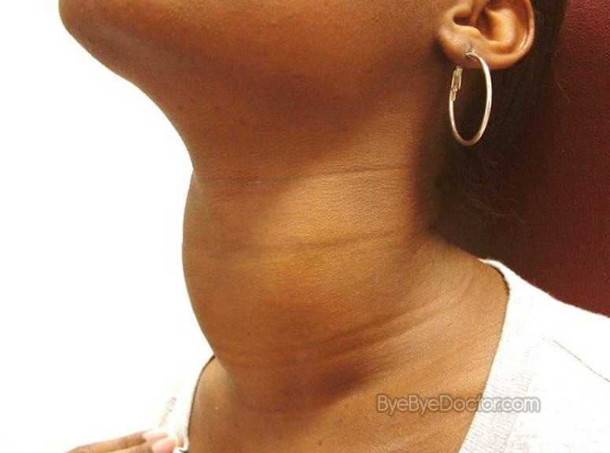
Visual location: x=6172200, y=2129720, width=5181600, height=3851098 EMU.

## Slide 162

- Goiter

- More common in females
- Iodine deficiency is most common cause worldwide
- Autoimmune MCC in US
- Goiter is a physical exam finding or may be incidentally seen on imaging performed for other reasons

## Slide 163

- Goiter

- Majority are asymptomatic but may have hypothyroidism or hyperthyroidism depending on the cause
- May cause compressive symptoms with increased growth (i.e. trachea)
- May be diffusely enlarged or nodular
- Once identified, workup should be initiated to assess thyroid size, function and nodules as well as identify underlying cause
  - Initially: thyroid function tests

## Slide 164

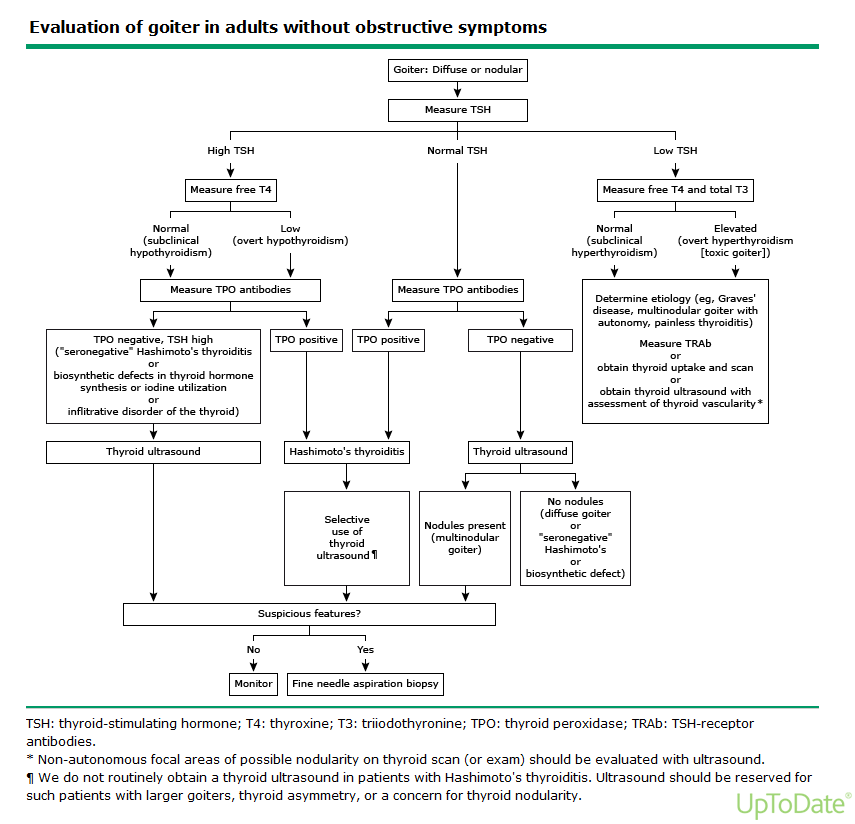
Visual location: x=2736850, y=0, width=6718300, height=6477000 EMU.

## Slide 165

- Goiter

- Additional tests:
  - Include non-contrast CT or MRI if compressive symptoms are present
  - FNA biopsy indicated if suspicious nodules on ultrasound or RAIU scan
- Treatment depends on the underlying cause
  - Total or near-total thyroidectomy is indicated for large goiters (>80 mL), rapidly growing goiters, concerning FNA biopsy results or goiters with compression on adjacent structures

## Slide 166

- Solitary thyroid nodules

## Slide 167

- Solitary nodule

- DDx:
  - Benign: adenoma, colloid nodule or cyst
  - Malignant: Primary or metastasis

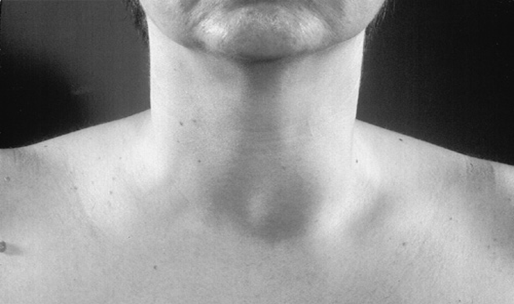
Visual location: x=6172200, y=2522335, width=5181600, height=3065868 EMU.

## Slide 168

- Solitary nodule

- Increased risk of malignancy:
  - Prior head/ neck radiation or nuclear radiation exposure
  - Family hx of thyroid CA
  - Personal history of malignancy
  - Rapid nodule growth and recent onset
  - Young patients
  - Male > Female

## Slide 169

- Solitary nodule

- Physical Exam should include characteristics of nodule (soft/firm, mobile/fixed, tenderness, size, location) as well as assessment for cervical lymphadenopathy
- Diagnostic workup should initially include thyroid function tests and ultrasound
  - TFTs are usually normal in malignancy
  - A solid lesion on ultrasound is more concerning for malignancy

## Slide 170

- Solitary nodule

- Suspicious nodules on ultrasound should undergo FNA biopsy
  - Best performed under U/S guidance and read by experienced cytopathologist
    - False positives & false negatives both occur at a rate of ~4%
  - Pts with a negative thyroid FNA should be monitored with follow-up exams and U/S
    - If nodules continue to grow, they should be re-biopsied or excised

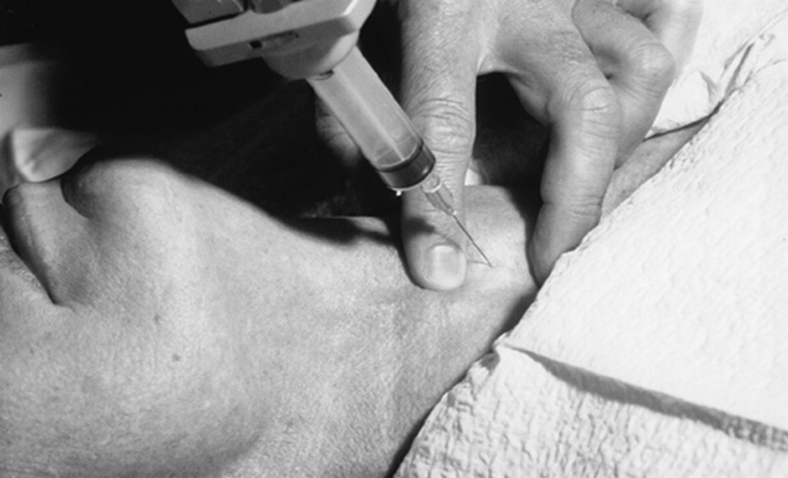
Visual location: x=9378778, y=0, width=2813222, height=1712123 EMU.

## Slide 171

- Solitary nodule

- Additional workup:
  - Solitary nodules and hyperthyroidism require RAIU scan and antibody testing to differentiate concerning malignant nodule from Grave’s disease/toxic adenoma/toxic multinodular goiter
    - A hot nodule is generally benign
    - A cold nodule is more concerning for malignancy

## Slide 172

- Solitary nodule

- Prognosis:
  - Great majority of thyroid nodules are benign, however previously biopsied benign nodules that grow may become malignant
  - Prognosis of malignant nodules depends on histology

## Slide 173

- Thyroid malignancy

## Slide 174

- Thyroid malignancy

- Account for 1% of all cancers in adults 4/100,000 in US
- Most are asymptomatic
- Thyroid function tests are typically normal
- Three type arise form thyroid cells
  - Papillary
  - Follicular
  - Anaplastic
- Medullary thyroid cancer
- Lymphoma of the thyroid

## Slide 175

- Papillary – Thyroid CA

- Most common type (80% of thyroid cancer)
- Best prognosis 
- Age at onset: 40-80 years
- W>M
- Slow growing
- Treated with thyroidectomy and then I-131 ablation
- 10 yr. survival is >80%

## Slide 176

- Follicular – Thyroid CA

- More aggressive than papillary
- 10-15% of thyroid cancers are this type
- Typical age at onset: 45-80 years
- May cause locally invasive disease
- May metastasize hematogenously to bone, brain or lung
- Treatment with thyroidectomy and then I131 ablation
- 10 yr. survival-40%

## Slide 177

- Anaplastic – Thyroid CA

- Least common type (1-3% of thyroid cancers)
- Very aggressive with worst prognosis
- Causes rapidly progressive pain, dysphagia and hoarseness
- Age at onset: 50-80 years
- Treatment with isthmectomy to prevent tracheal compression and then palliative radiation
- Mean survival is 2-4 months

## Slide 178

- Medullary Thyroid Cancer 

- A malignancy of the calcitonin-producing cells (C-cells) within the thyroid
-  3-7% of thyroid cancers
- More aggressive than papillary or follicular thyroid cancers
- Typically presents as a solitary nodule in the upper areas of the thyroid but can be multifocal
- Age at onset: 30-60 years

## Slide 179

- Medullary Thyroid Cancer 

- High calcitonin levels
- Tumor marker CEA is usually elevated as well
- ¼ MTC are associated with MEN-2 syndrome
  - Workup for pheochromocytoma and parathyroid tumors
  - Genetic testing for RET mutations
- TX-total thyroidectomy with central lymph node resection
- Prognosis varies based on staging (I = 100%; IV = 21%)

## Slide 180

- Lymphoma of the Thyroid

- The malignancy of the thyroid lymphocytes
- Rare; 1% of thyroid cancers
- More likely to occur in patients with Hashimoto’s
- Present with rapidly enlarging painless neck mass +/- compressive symptoms
- Treatment with chemo & radiation; possibly surgery to relieve compressive symptoms
- Overall survival rate is 50-70% in 5 years

## Slide 181

- One more time now…

- Thyroiditis
- Goiters
- Solitary nodules
  - malignancy

## Slide 182

