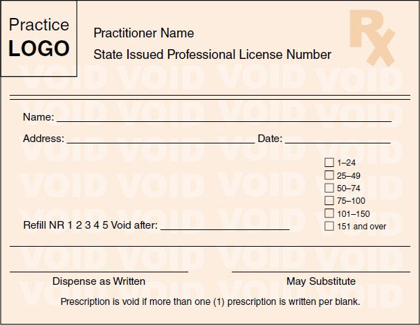

# Thyroid Pharmacology

Source: `Thyroid Pharmacology - students.pptx` — 21 slides.

Complete slide-by-slide reference extraction. Text and table cells are preserved, including lecture wording. Embedded visuals are linked below and retained at original quality. Read those images when a slide is primarily a diagram or image-based table. This is lecture source context, not independently updated clinical guidance.

## Slide 1

- Thyroid Pharmacology

- Pamela E. Wireman, MPAS, PA-C

Additional slide resources:
- https://www.pexels.com/photo/mixed-medicinal-capsules-with-pills-and-tablets-in-variety-tableware-on-marble-desk-3850692/

## Slide 2

- Levothyroxine

- Indication: hypothyroidism
- Synthetic thyroxine (T4)
- Brand names: Synthroid, Levoxyl, Levothyroid
- Dosage: 
  - Initially 25-50mcg PO daily; may increase by 12-25mcg every 6 weeks until TSH is WNL
  - Rarely exceed 300mcg PO daily
  - Expect to increase dosages if pt becomes pregnant or gains significant weight
  - Expect to decrease dosages as the person advances in age, after childbirth, or if significant weight loss
- Therapeutic effects may take up to 6 weeks

Additional slide resources:
- [Embedded media](../assets/thyroid-pharmacology/model3d1.glb)

## Slide 3

- Levothyroxine – BLACK BOX WARNING

- WARNING: NOT FOR TREATMENT OF OBESITY OR FOR WEIGHT LOSS
- Thyroid hormones, including SYNTHROID should not be used for the treatment of obesity or for weight loss.
- Doses beyond the range of daily hormonal requirements may produce serious or even life-threatening manifestations of toxicity.

## Slide 4

- Levothyroxine

- Adverse effects: Most noteworthy 
  - Cardiovascular (angina pectoris, arrythmia, HTN, MI, palpitations, tachycardia): start low, go slow in patients with cardiovascular disease and the elderly; reduce dose if CV symptoms occur or worsen
- Considerations: 
  - For adequate absorption, pts should take consistently every morning on an empty stomach at least 30 minutes prior to food
    - Must also separate from calcium or iron-containing products by 4 hours

Additional slide resources:
- [Embedded media](../assets/thyroid-pharmacology/model3d1.glb)

## Slide 5

- Levothyroxine

- Considerations: 
  - Has a low therapeutic index
  - Slight changes between manufacturers can have significant effects, thus the patient should try to use the same manufacturer whenever possible
    - i.e. “Dispense as written” 

Visual descr: Dispensing Controlled Substances | Basicmedical Key

Visual location: x=6172202, y=1825625, width=5631690, height=4351338 EMU.

Additional slide resources:
- [Embedded media](../assets/thyroid-pharmacology/model3d1.glb)

## Slide 6

- Liothyronine

- Indication: hypothyroidism
- Synthetic triiodothyronine (T3)
- Brand names: Cytomel, Triostat
- Dosage:
  - Initially 25mcg PO daily; may increase by 25mcg every 1-2 weeks until TSH is WNL
  - Usual dose is 25 – 75 mcg
  - Elderly and patients with CV disease should start lower: 5mcg PO daily and only increase by 5mcg every 2 weeks if needed
- Therapeutic effects are quicker; can reassess at 2 weeks

Additional slide resources:
- [Embedded media](../assets/thyroid-pharmacology/model3d1.glb)

## Slide 7

- Liothyronine – BLACK BOX WARNING

- WARNING: NOT FOR TREATMENT OF OBESITY OR FOR WEIGHT LOSS
- Thyroid hormones, including SYNTHROID should not be used for the treatment of obesity or for weight loss.
- Doses beyond the range of daily hormonal requirements may produce serious or even life-threatening manifestations of toxicity.

## Slide 8

- Liothyronine

- Adverse effects: Most noteworthy 
  - cardiovascular – same as levothyroxine but more potent
- Considerations: 
  - Use proper drug name; avoid writing “T3” – mistaken for Tylenol #3 (acetaminophen + codeine)
  - Also has a low therapeutic index
  - Quicker onset than levothyroxine but less preferred for treatment of hypothyroidism due to its higher potency – greater risk for toxicity

Additional slide resources:
- [Embedded media](../assets/thyroid-pharmacology/model3d1.glb)

## Slide 9

- Desiccated thyroid extract

- Indication: hypothyroidism
- Naturally occurring – made from powderized dried pig thyroid but contains synthetic fillers
- Brand names: Armour Thyroid
- Contains both T4 and T3, as well as unmeasured calcitonin
- Dosage:
  - Measured in “grains” which is around 38 mcg of T4 and 9 mcg of T3
- Considerations: 
  - Considerable inconsistencies in the strength of a prescribed dose; unable to truly know the exact amount a patient is taking – resulting in supratherapeutic and subtherapeutic levels

Additional slide resources:
- [Embedded media](../assets/thyroid-pharmacology/model3d1.glb)

## Slide 10

- Methimazole

- Indication: Hyperthyroidism and Thyroid Storm
- Brand name: Tapazole
- Category: Antithyroid medication – thionamides
  - MOA: inhibits production of TH by blocking oxidation of iodine in the thyroid
- Dosage: 
  - Mild: 5-10mg once daily
  - Severe: 20-40mg/daily (can be given in divided doses) 
  - Thyroid storm: 20mg every 4-6 hours; once stable, decrease frequency (if unable to give orally, can administer by NG tube or rectally)

Additional slide resources:
- [Embedded media](../assets/thyroid-pharmacology/model3d2.glb)

## Slide 11

- Methimazole

- Monitoring: 
  - Free T3 and T4 at 6-week intervals
    - When normal thyroid hormones are achieved, decrease dose by 30% and repeat TFTs in 6 weeks until TSH is WNL
    - TSH will initially lag for months
  - CBC, LFTs
  - Pt should report any signs/symptoms of illness (i.e. sore throat, fever)
- Noteworthy AE:
  - Blood dyscrasias: Agranulocytosis, thrombocytopenia, others
  - Hepatitis
  - Acute pancreatitis
  - Vasculitis

Additional slide resources:
- [Embedded media](../assets/thyroid-pharmacology/model3d2.glb)

## Slide 12

- Methimazole

- Considerations:
  - In thyroid storm, must give before iodine (at least 1-hour prior)
  - Longer duration than PTU, generally less side effects, more rapid onset
  - Birth defects have been associated (anomalies of the GI tract, respiratory tract, skin, face, and hypothyroidism) with its use
    - However, the risk of uncontrolled maternal hyperthyroidism causes significant morbidity and mortality as well
    - Generally only use in 2nd and 3rd trimester

Additional slide resources:
- [Embedded media](../assets/thyroid-pharmacology/model3d2.glb)

## Slide 13

- Propylthiouracil (PTU)

- Indication: hyperthyroidism
  - Second line anti-thyroid medication (use methimazole instead if able) except it is used 1st line in 1st trimester pregnancy
- Brand name: none
- Category: antithyroid medication; thionamide
  - MOA – same as methimazole but also blocks peripheral conversion of T4 to T3
- Dosing: initially 100mg three times a day
  - As clinical condition improves, reduce dosage; typical maintenance dose is usually 50mg three times a day
- Monitoring:
  - TFTs – similar to methimazole
  - LFTs – need to discontinue when 3x ULN
  - CBC, BMP

Additional slide resources:
- [Embedded media](../assets/thyroid-pharmacology/model3d2.glb)

## Slide 14

- Propylthiouracil (PTU) – BLACK BOX WARNING

- WARNING: Severe liver injury and acute liver failure, in some cases fatal, have been reported in patients treated with propylthiouracil. These reports of hepatic reactions include cases requiring liver transplantation in adults and pediatric patients.
- Reserve propylthiouracil for patients who cannot tolerate methimazole and in whom radioactive iodine therapy or surgery are not appropriate treatments for the management of hyperthyroidism.

Additional slide resources:
- [Embedded media](../assets/thyroid-pharmacology/model3d2.glb)

## Slide 15

- Propylthiouracil (PTU)

- Noteworthy AE: too many to list!
  - Hepatoxicity
  - Agranulocytosis
  - Stevens-Johnson syndrome and toxic epidermal necrolysis (severe skin disorders)
  - Renal failure
- Considerations:
  - Lost its FDA approval for pediatrics due to hepatoxicity
  - Considered “hazardous” and precautions are recommended for handling medication 
  - Many Drug interactions – always check
  - Though it’s preferred over methimazole in 1st trimester pregnancy, it is still pregnancy category D
    - Fetal hypothyroidism and goiter

Additional slide resources:
- [Embedded media](../assets/thyroid-pharmacology/model3d2.glb)

## Slide 16

- Atenolol

- Indication specific: hyperthyroid symptoms
- Brand: Tenormin
- Category: Beta-1 selective; anti-adrenergic; beta blocker
- Dosing: 
  - Initial: 25 – 50mg once a day, titrating up as needed to maintain heart rate between 60-90 bpm
  - Max is 100mg twice a day
  - Once euthyroid is achieved with targeted thyroid therapies, symptoms will resolve and beta blocker can be discontinued

Additional slide resources:
- [Embedded media](../assets/thyroid-pharmacology/model3d2.glb)

## Slide 17

- Atenolol

- Noteworthy AE: 
  - Hypotension, bradycardia, fatigue, dizziness, bronchospasm
- Contraindicated: 
  - asthma, COPD, PVD, Raynaud phenomenon, bradycardia, 2nd or 3rd degree heart block
- Advantage of atenolol: 
  - single day dosing (ease of use for patients) and beta-1 selective

Additional slide resources:
- [Embedded media](../assets/thyroid-pharmacology/model3d2.glb)

## Slide 18

- Propranolol

- Indication specific: hyperthyroid symptoms and thyroid storm
- Brand: Inderal
- Category: Non-selective beta blocker
- Dosing: 
  - Initial: 30 to 160 mg/day, titrating up as needed to maintain heart rate between 60-90 bpm
    - Once euthyroid is achieved with targeted thyroid therapies, symptoms will resolve and beta blocker can be discontinued

Additional slide resources:
- [Embedded media](../assets/thyroid-pharmacology/model3d2.glb)

## Slide 19

- Propranolol

- Dosing for thyroid storm:
  - IV: 1 mg administered over 10 minutes (need continuous cardiac monitoring)
    - a repeat dose of 1 to 3 mg over 10 to 15 minutes may be given every few hours as needed until oral therapy can be initiated
- Noteworthy AE: 
  - Hypotension, bradycardia, fatigue, dizziness, bronchospasm
- Contraindicated: 
  - asthma, COPD, PVD, Raynaud phenomenon, bradycardia, 2nd or 3rd degree heart block

Additional slide resources:
- [Embedded media](../assets/thyroid-pharmacology/model3d2.glb)

## Slide 20

- Methylprednisolone

- Indication: severe Graves’ orbitopathy
- Route: IV
- Dosage: Pulse therapy – once a week
- Increasingly favorable approach due to less side effects

- Prednisone

- Indication: moderate to severe Graves’ orbitopathy
- Route: oral
- Dosage: 30mg – 100mg per day
- 50% have improvement within 6 months
- As improvement occurs, taper dose to lowest possible
- Considerations: many risks with long-term steroid therapy
  - Osteoporosis
  - H-P-A suppression

- Dexamethasone

- Indication: sight-threatening Graves’ orbitopathy
- Route: IV
- Dosage: 4mg 
- Given while preparing for orbital decompression surgery

- Steroids

Additional slide resources:
- [Embedded media](../assets/thyroid-pharmacology/model3d2.glb)

## Slide 21

- This Photo by Unknown Author is licensed under CC BY-SA
  Link: http://cooking.stackexchange.com/questions/60324/how-long-should-i-cook-a-steak-to-make-it-medium-rare
  Link: https://creativecommons.org/licenses/by-sa/3.0/

- Well done my friends

Visual descr: Diagram

Description automatically generated with low confidence

Visual location: x=0, y=0, width=4572000, height=6858000 EMU.

Additional slide resources:
- https://creativecommons.org/licenses/by-sa/3.0/
- http://cooking.stackexchange.com/questions/60324/how-long-should-i-cook-a-steak-to-make-it-medium-rare
